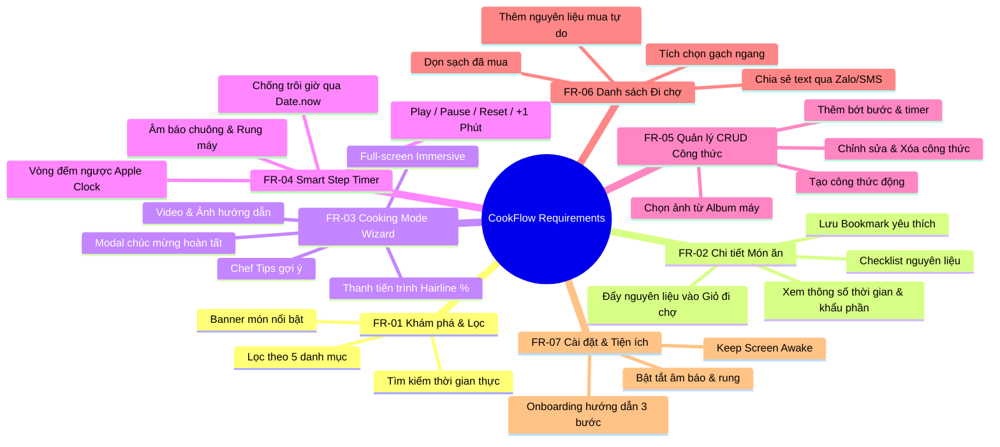
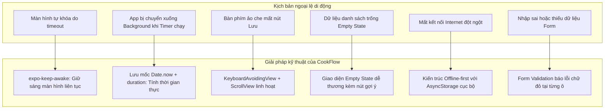
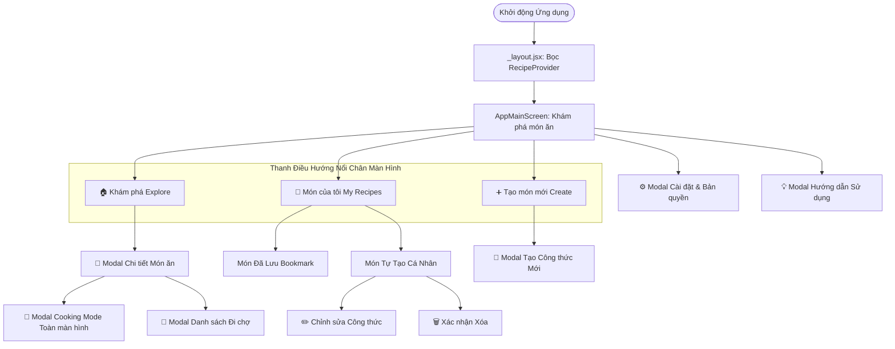
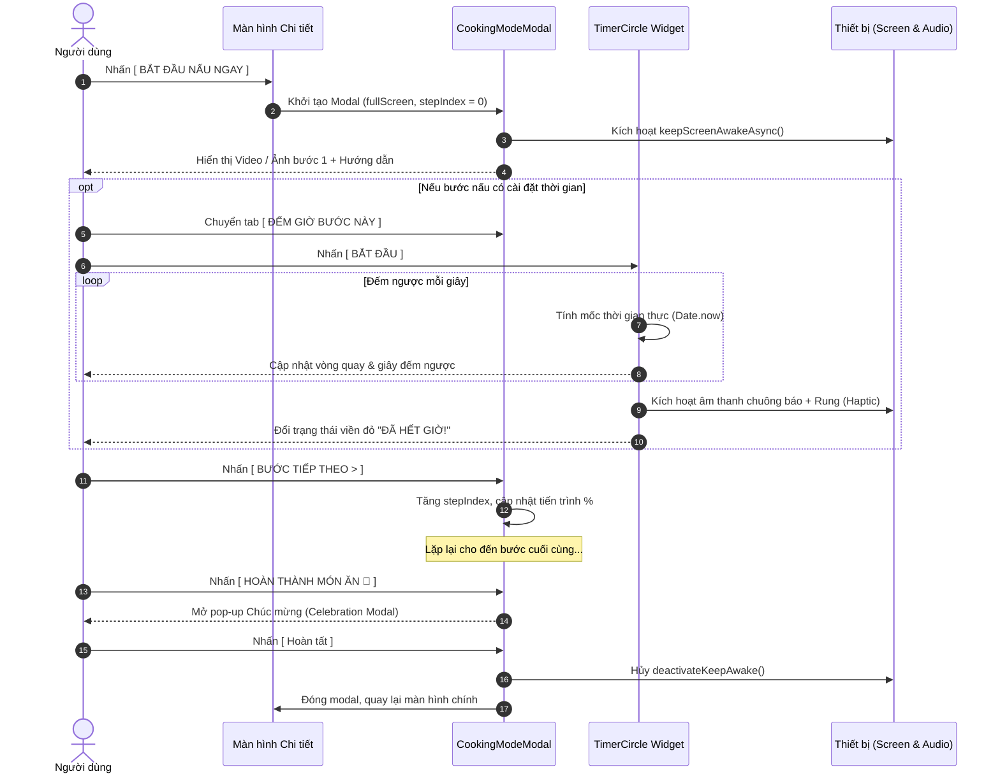
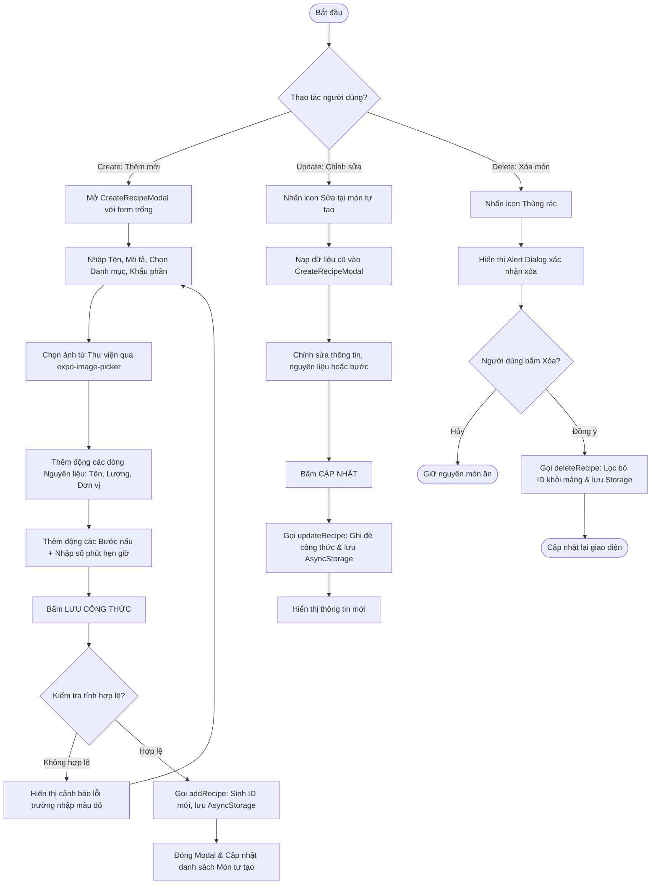
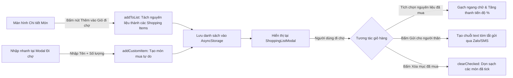
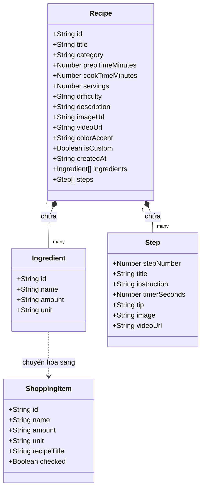
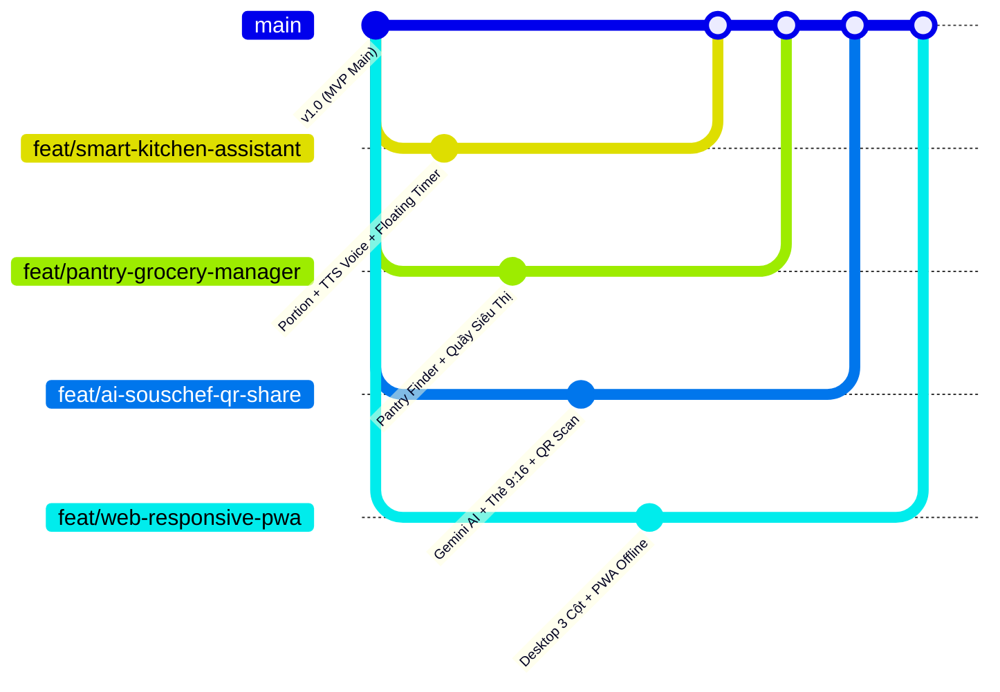

# 📚 BÁO CÁO TỔNG QUAN ĐỒ ÁN MÔN HỌC MMA301
# ĐỀ TÀI: COOKFLOW – TRỢ LÝ NẤU ĂN TỪNG BƯỚC ĐA NỀN TẢNG THÔNG MINH
> **Trường Đại học FPT - Khối ngành Công nghệ Thông tin**  
> **Môn học:** MMA301 – Multiplatform Mobile App Development  
> **Nền tảng phát triển:** React Native / Expo SDK 57 (JavaScript ES6+ / JSX)  
> **Phiên bản báo cáo:** 1.0 (Bản hoàn chỉnh tổng hợp Kế hoạch, Yêu cầu, Kiến trúc & Kế hoạch tiếp theo)  
> **Thời gian thực hiện:** Học kỳ Fall 2026  

---

## 📑 MỤC LỤC BÁO CÁO

- [CHƯƠNG 1: TỔNG QUAN ĐỀ TÀI & BỐI CẢNH DỰ ÁN](#chương-1-tổng-quan-đề-tài--bối-cảnh-dự-án)
  - [1.1. Lý do chọn đề tài & Tính cấp thiết](#11-lý-do-chọn-đề-tài--tính-cấp-thiết)
  - [1.2. Mục tiêu nghiên cứu & phát triển (App Objectives)](#12-mục-tiêu-nghiên-cứu--phát-triển-app-objectives)
  - [1.3. Đối tượng người dùng mục tiêu (Target Personas)](#13-đối-tượng-người-dùng-mục-tiêu-target-personas)
  - [1.4. Phạm vi & Giới hạn của dự án (Scope & Boundaries)](#14-phạm-vi--giới-hạn-của-dự-án-scope--boundaries)
- [CHƯƠNG 2: ĐẶC TẢ YÊU CẦU HỆ THỐNG (SYSTEM REQUIREMENTS)](#chương-2-đặc-tả-yêu-cầu-hệ-thống-system-requirements)
  - [2.1. Danh mục Yêu cầu Chức năng (Functional Requirements - FR)](#21-danh-mục-yêu-cầu-chức-năng-functional-requirements---fr)
  - [2.2. Danh mục Yêu cầu Phi Chức năng (Non-Functional Requirements - NFR)](#22-danh-mục-yêu-cầu-phi-chức-năng-non-functional-requirements---nfr)
  - [2.3. Ma trận xử lý kịch bản ngoại lệ di động (Mobile Edge Cases)](#23-ma-trận-xử-lý-kịch-bản-ngoại-lệ-di-động-mobile-edge-cases)
- [CHƯƠNG 3: THIẾT KẾ KIẾN TRÚC & HỆ THỐNG QUY TRÌNH (WORKFLOWS)](#chương-3-thiết-kế-kiến-trúc--hệ-thống-quy-trình-workflows)
  - [3.1. Kiến trúc phân tầng kỹ thuật (Technical Layer Architecture)](#31-kiến-trúc-phân-tầng-kỹ-thuật-technical-layer-architecture)
  - [3.2. Sơ đồ điều hướng màn hình (App Sitemap & Navigation Flow)](#32-sơ-đồ-điều-hướng-màn-hình-app-sitemap--navigation-flow)
  - [3.3. Đặc tả chi tiết các Quy trình nghiệp vụ cốt lõi (Core Workflows)](#33-đặc-tả-chi-tiết-các-quy-trình-nghiệp-vụ-cốt-lõi-core-workflows)
  - [3.4. Mô hình cấu trúc dữ liệu thực thể (Data Schemas)](#34-mô-hình-cấu-trúc-dữ-liệu-thực-thể-data-schemas)
- [CHƯƠNG 4: KẾT QUẢ THỰC HIỆN MVP HIỆN TẠI](#chương-4-kết-quả-thực-hiện-mvp-hiện-tại)
  - [4.1. Cấu trúc tổ chức thư mục mã nguồn](#41-cấu-trúc-tổ-chức-thư-mục-mã-nguồn)
  - [4.2. Các thành phần giao diện & Module đã hoàn thành](#42-các-thành-phần-giao-diện--module-đã-hoàn-thành)
  - [4.3. Bảng đối chiếu Chuẩn đầu ra môn học MMA301 (CLO Mapping)](#43-bảng-đối-chiếu-chuẩn-đầu-ra-môn-học-mma301-clo-mapping)
- [CHƯƠNG 5: KẾ HOẠCH & TIẾN TRÌNH PHÁT TRIỂN TIẾP THEO (NEXT STEPS)](#chương-5-kế-hoạch--tiến-trình-phát-triển-tiếp-theo-next-steps)
  - [5.1. Quy trình quản trị Git Flow & Mô hình phân nhánh](#51-quy-trình-quản-trị-git-flow--mô-hình-phân-nhánh)
  - [5.2. Chi tiết 4 Nhánh phát triển tính năng mới](#52-chi-tiết-4-nhánh-phát-triển-tính-năng-mới)
  - [5.3. Tiêu chí nghiệm thu (Definition of Done - DoD)](#53-tiêu-chí-nghiệm-thu-definition-of-done---dod)
- [CHƯƠNG 6: KẾT LUẬN & ĐÁNH GIÁ](#chương-6-kết-luận--đánh-giá)

---

## 🏷️ DANH MỤC TỪ VIẾT TẮT & THUẬT NGỮ KỸ THUẬT

| Thuật ngữ / Viết tắt | Giải nghĩa đầy đủ |
| :--- | :--- |
| **MMA301** | Multiplatform Mobile App Development (Môn học phát triển ứng dụng di động đa nền tảng) |
| **FR** | Functional Requirement (Yêu cầu chức năng) |
| **NFR** | Non-Functional Requirement (Yêu cầu phi chức năng) |
| **CRUD** | Create, Read, Update, Delete (Bốn thao tác dữ liệu cơ bản: Tạo, Xem, Sửa, Xóa) |
| **CLO** | Course Learning Outcome (Chuẩn đầu ra của học phần) |
| **DoD** | Definition of Done (Tiêu chuẩn hoàn thành tính năng) |
| **PWA** | Progressive Web App (Ứng dụng web tiến bộ có thể cài đặt như app native) |
| **HIG** | Human Interface Guidelines (Bộ quy chuẩn giao diện người dùng của Apple) |
| **TTS** | Text-To-Speech (Tổng hợp chuyển văn bản thành giọng nói đọc) |
| **P2P** | Peer-to-Peer (Giao thức trao đổi ngang hàng trực tiếp không qua trung gian server) |

---

# CHƯƠNG 1: TỔNG QUAN ĐỀ TÀI & BỐI CẢNH DỰ ÁN

## 1.1. Lý do chọn đề tài & Tính cấp thiết
Nấu ăn tại nhà là một nhu cầu sinh hoạt thiết yếu mang lại giá trị sức khỏe và gắn kết gia đình. Trong thời đại số hóa, người dùng tiếp cận với hàng ngàn công thức nấu ăn thông qua các trang web ẩm thực, blog cá nhân hoặc mạng xã hội (TikTok, Facebook, YouTube). Tuy nhiên, hầu hết các phương tiện này đều tồn tại các nhược điểm lớn khi áp dụng vào **bối cảnh thực tế trong gian bếp**:

1. **Khó theo dõi trong lúc nấu:** Các trang web công thức thường hiển thị dạng bài viết văn bản dài hoặc video dài. Khi người dùng đang đứng bếp, việc phải liên tục dùng tay cuộn trang để tìm lại bước đang nấu rất dễ gây nhầm lẫn và mất thời gian.
2. **Bất tiện khi thao tác trên điện thoại:** Màn hình điện thoại thông minh thường tự động tắt (screen timeout) sau 30–60 giây để tiết kiệm pin. Trong khi đó, tay người nấu ăn thường ướt, dính dầu mỡ hoặc bám gia vị; mỗi lần chạm vào điện thoại để mở khóa vừa gây mất vệ sinh vừa gián đoạn công đoạn chế biến.
3. **Quên hoặc sai lệch thời gian công đoạn:** Các kỹ thuật như hầm xương, ướp thịt, luộc trứng lòng đào, nướng bánh đòi hỏi độ chính xác cao về thời gian. Người dùng phải mở thêm ứng dụng đồng hồ bấm giờ bên ngoài rất rườm rà hoặc thường xuyên quên kích hoạt.
4. **Phân mảnh danh sách nguyên liệu và công thức:** Người dùng thường ghi chép công thức cá nhân rời rạc trên ứng dụng ghi chú hoặc giấy tờ, khó quản lý danh sách đi chợ tương ứng và khó chia sẻ cho người khác.

👉 **CookFlow ra đời nhằm giải quyết triệt để các vấn đề trên**, mang sứ mệnh biến chiếc điện thoại thông minh thành một **Trợ lý nhà bếp tương tác rảnh tay (Hands-free Step-by-Step Cooking Assistant)**.

## 1.2. Mục tiêu nghiên cứu & phát triển (App Objectives)
* **Xây dựng ứng dụng di động đa nền tảng (Cross-platform Mobile App):** Khai thác sức mạnh của React Native và Expo để mang lại trải nghiệm đồng nhất trên cả thiết bị Android, iOS và mở rộng lên Web/PWA.
* **Cung cấp Chế độ nấu ăn tập trung (Cooking Mode Wizard):** Chia nhỏ công thức thành từng bước độc lập, giao diện chữ to, có video minh họa, thanh tiến trình trực quan.
* **Tích hợp Bộ đếm giờ thông minh (Smart Step Timer):** Gắn liền bộ đếm ngược trực tiếp tại bước nấu cần canh thời gian, có âm thanh chuông báo và rung cảnh báo khi hoàn tất.
* **Tự động Giữ sáng màn hình (Keep Screen Awake):** Giữ màn hình luôn sáng trong suốt phiên nấu ăn, bảo đảm trải nghiệm không gián đoạn.
* **Quản lý dữ liệu công thức (Full CRUD) & Danh sách đi chợ:** Cung cấp đầy đủ công cụ tạo mới, xem, sửa, xóa công thức cá nhân và đồng bộ nguyên liệu vào giỏ đi chợ nội bộ (Offline-first).

## 1.3. Đối tượng người dùng mục tiêu (Target Personas)
1. **Persona 1: Người mới bắt đầu học nấu ăn (Beginners / Sinh viên):**
   * *Đặc điểm:* Chưa quen căn chỉnh thời gian gia vị, dễ lúng túng khi thực hiện nhiều thao tác cùng lúc.
   * *Nhu cầu:* Cần giao diện từng bước cực kỳ rõ ràng, bộ đếm giờ tự động báo hiệu, video/ảnh minh họa cụ thể cho từng khâu.
2. **Persona 2: Người bận rộn nấu ăn gia đình hàng ngày (Home Cooks):**
   * *Đặc điểm:* Cần chuẩn bị bữa ăn nhanh chóng, muốn tiết kiệm thời gian lên thực đơn và đi chợ.
   * *Nhu cầu:* Lọc món ăn nhanh dưới 15 phút, tính năng tạo danh sách đi chợ tự động từ món ăn yêu thích.
3. **Persona 3: Người đam mê sáng tạo món ăn (Home Chefs / Food Lovers):**
   * *Đặc điểm:* Có nhiều công thức gia truyền hoặc tự nghiên cứu riêng muốn số hóa.
   * *Nhu cầu:* Trình tạo công thức cá nhân linh hoạt, hỗ trợ gắn timer riêng từng bước và chia sẻ công thức cho bạn bè.

## 1.4. Phạm vi & Giới hạn của dự án (Scope & Boundaries)
* **Phạm vi kỹ thuật:** Ứng dụng client-side di động phát triển trên nền tảng React Native / Expo Router, áp dụng kiến trúc Offline-First sử dụng Local Storage (`AsyncStorage` / `localStorage`).
* **Giới hạn phiên bản hiện tại:**
  * Sử dụng kho dữ liệu mẫu chuẩn bị sẵn (Mock Data chuyên sâu) kết hợp lưu trữ cục bộ cho các thao tác CRUD của người dùng.
  * Chưa kết nối hệ thống Backend phân tán Microservices (sẽ được mở rộng ở các giai đoạn tiếp theo).

---

# CHƯƠNG 2: ĐẶC TẢ YÊU CẦU HỆ THỐNG (SYSTEM REQUIREMENTS)

## 2.1. Danh mục Yêu cầu Chức năng (Functional Requirements - FR)



### Bảng chi tiết Yêu cầu Chức năng:

| Mã FR | Tên chức năng | Mô tả chi tiết hành vi hệ thống | Mức ưu tiên |
| :--- | :--- | :--- | :---: |
| **FR-01.1** | Lọc danh mục | Người dùng có thể lọc danh sách món theo 5 danh mục: *Tất cả, Món nhanh ⚡, Món chính 🍲, Ăn kiêng 🥗, Tráng miệng 🍰, Thức uống 🍹*. | Cao |
| **FR-01.2** | Tìm kiếm món ăn | Cho phép tìm kiếm thời gian thực theo tiêu đề món ăn, mô tả tóm tắt hoặc tên bất kỳ nguyên liệu nào có trong món. | Cao |
| **FR-01.3** | Món nổi bật | Hiển thị thẻ món ăn nổi bật với giao diện thẻ lớn, hiển thị thời gian chuẩn bị, thời gian nấu và mức độ khó. | Trung bình |
| **FR-02.1** | Xem chi tiết công thức | Mở modal chi tiết hiển thị ảnh chất lượng cao, độ khó, thời gian, mô tả và khẩu phần ăn. | Cao |
| **FR-02.2** | Checklist nguyên liệu | Hiển thị danh sách nguyên liệu định lượng rõ ràng; người dùng có thể tích chọn từng nguyên liệu đã chuẩn bị. | Cao |
| **FR-02.3** | Thêm vào Giỏ đi chợ | Nhấn nút "Thêm vào Danh sách đi chợ" sẽ tự động đẩy toàn bộ các nguyên liệu vào danh sách mua sắm. | Cao |
| **FR-02.4** | Đánh dấu Yêu thích | Nhấn biểu tượng Trái tim để thêm/xóa món ăn khỏi danh sách yêu thích, kích hoạt rung haptic nhẹ và lưu vào storage. | Cao |
| **FR-03.1** | Chế độ Cooking Mode | Toàn màn hình (Full-screen Modal), ẩn hoàn toàn thanh điều hướng để người dùng tập trung tuyệt đối vào việc nấu. | Cao |
| **FR-03.2** | Tiến trình nấu ăn | Hiển thị thông số bước hiện tại (`GIAI ĐOẠN 0X // 0Y`) và thanh tiến trình phần trăm (%) sắc nét. | Cao |
| **FR-03.3** | Video & Ảnh minh họa | Tích hợp trình phát video bước StepVideoPlayer, hỗ trợ tự chuyển về ảnh dự phòng nếu không có video. | Trung bình |
| **FR-03.4** | Chuyển chế độ xem | Hỗ trợ nút chuyển đổi giữa `HƯỚNG DẪN CHI TIẾT` và `ĐẾM GIỜ BƯỚC NÀY` để người dùng linh hoạt thao tác. | Cao |
| **FR-03.5** | Điều hướng bước | Nút bấm lớn `[ < BƯỚC TRƯỚC ]` và `[ BƯỚC TIẾP THEO > ]`, có kiểm tra nếu là bước cuối thì chuyển thành `[ HOÀN THÀNH MÓN ĂN ]`. | Cao |
| **FR-03.6** | Màn hình chúc mừng | Khi nấu xong bước cuối, mở pop-up chúc mừng (Celebration Modal) tạo cảm giác phấn khởi cho người dùng. | Trung bình |
| **FR-04.1** | Vòng đếm ngược Timer | Vòng tròn hiển thị phút:giây đếm ngược, chuyển động đổi màu theo trạng thái (Sẵn sàng ➡️ Đang đếm 🔥 ➡️ Hết giờ 🔔). | Cao |
| **FR-04.2** | Điều khiển Timer | Hỗ trợ các nút: Bắt đầu, Tạm dừng, Đặt lại về thời gian ban đầu, và nút tiện ích `+1 Phút`. | Cao |
| **FR-04.3** | Cảnh báo hết giờ | Khi đồng hồ về `00:00`, tự động kích hoạt rung máy và chuông báo động vui nhộn. | Cao |
| **FR-05.1** | Tạo công thức mới (Create) | Mở form động: nhập tên, mô tả, khẩu phần, độ khó; chọn ảnh từ thư viện máy thông qua `expo-image-picker`; thêm/xóa nguyên liệu và bước nấu linh hoạt. | Cao |
| **FR-05.2** | Xem danh sách món tự tạo (Read) | Tab *Món của tôi* hiển thị danh sách các món do người dùng tự nhập với nhãn riêng biệt `TỰ TẠO`. | Cao |
| **FR-05.3** | Chỉnh sửa công thức (Update) | Cho phép mở lại form điền sẵn dữ liệu cũ để cập nhật nguyên liệu, bước nấu và thời gian timer. | Cao |
| **FR-05.4** | Xóa công thức (Delete) | Hỗ trợ xóa món tự tạo kèm hộp thoại xác nhận cảnh báo tránh xóa nhầm. | Cao |
| **FR-06.1** | Quản lý Giỏ đi chợ | Hiển thị danh sách các món cần mua, cho phép bấm tích hoàn thành để gạch ngang nguyên liệu đã mua. | Cao |
| **FR-06.2** | Nhập nguyên liệu tự do | Cho phép thêm nhanh nguyên liệu đi chợ ngoài (Tên nguyên liệu, số lượng, đơn vị) mà không cần gắn vào công thức. | Cao |
| **FR-06.3** | Dọn dẹp & Chia sẻ | Nút "Xóa mục đã mua" để dọn gọn giỏ hàng; nút "Chia sẻ" xuất định dạng chuỗi văn bản danh sách nguyên liệu. | Trung bình |
| **FR-07.1** | Giữ sáng màn hình | Tùy chọn `Keep Screen Awake` tích hợp với `expo-keep-awake` đảm bảo màn hình không bị tắt khi đang nấu. | Cao |
| **FR-07.2** | Hướng dẫn Onboarding | Hiển thị modal hướng dẫn người dùng mới với 3 bước thao tác cốt lõi khi khởi động lần đầu hoặc mở từ nút trợ giúp 💡. | Trung bình |

---

## 2.2. Danh mục Yêu cầu Phi Chức năng (Non-Functional Requirements - NFR)

| Mã NFR | Tiêu chí | Nội dung đặc tả kỹ thuật |
| :--- | :--- | :--- |
| **NFR-01** | **Hiệu năng & Tốc độ (Performance)** | • Giao diện đáp ứng mượt mà ở tần số quét 60Hz/120Hz.<br/>• Thời gian phản hồi xúc giác khi bấm nút < 100ms.<br/>• Tận dụng `FlatList` ảo hóa dữ liệu để tối ưu dung lượng RAM khi danh sách món ăn mở rộng lên hàng trăm món. |
| **NFR-02** | **Tính sẵn sàng & Ngoại tuyến (Offline-First)** | • Ứng dụng có thể khởi chạy và hoạt động 100% tính năng mà không cần mạng Internet.<br/>• Cơ chế `safeStorage` bao bọc thông minh: Tự dùng `@react-native-async-storage/async-storage` trên di động và chuyển đổi `localStorage` trên Web để bảo đảm không bị crash. |
| **NFR-03** | **Tiêu chuẩn Thiết kế UI/UX (Design Aesthetics)** | • Áp dụng triệt để Apple iOS Human Interface Guidelines: Bo góc tròn mềm mại (`Radius` 24px - 32px), bảng màu pastel ấm áp (Màu chủ đạo Coral `#FF6B6B`, Mint `#38D9A9`, Honey `#FFD43B`).<br/>• Hệ thống đổ bóng mềm nhiều lớp (`HeronShadow`).<br/>• Nút bấm tương tác kích thước lớn (chiều cao $\ge 48$px), khoảng cách nhấn thoải mái phù hợp với ngón tay người dùng trong bếp. |
| **NFR-04** | **Tính thích ứng Bàn phím (Keyboard UX)** | • Sử dụng `KeyboardAvoidingView` và `ScrollView` trong màn hình nhập liệu công thức, đảm bảo bàn phím ảo không che khuất các nút bấm hoặc trường nhập cuối cùng. |
| **NFR-05** | **Khả năng Bảo trì & Mở rộng (Maintainability)** | • Phân chia rõ ràng thành các tầng: `app/` (routes), `components/` (UI/Modals), `context/` (State Management), `constants/` (Theme Tokens), `data/` (Mock Data).<br/>• Mã nguồn viết bằng JavaScript chuẩn ES6+ / JSX, comment giải thích rõ ràng các hàm nghiệp vụ. |

---

## 2.3. Ma trận xử lý kịch bản ngoại lệ di động (Mobile Edge Cases)

Để đạt điểm xuất sắc trong đồ án môn MMA301, CookFlow chủ động thiết kế giải pháp xử lý toàn diện cho các vấn đề ngoại lệ đặc trưng của nền tảng di động:



---

# CHƯƠNG 3: THIẾT KẾ KIẾN TRÚC & HỆ THỐNG QUY TRÌNH (WORKFLOWS)

## 3.1. Kiến trúc phân tầng kỹ thuật (Technical Layer Architecture)

CookFlow được xây dựng theo mô hình phân tầng chuẩn mực cho ứng dụng di động:

```mermaid
flowchart TB
    subgraph UI_Presentation [TẦNG GIAO DIỆN & TRÌNH DIỄN (Presentation Layer)]
        ScreenMain["Màn hình chính AppMainScreen (index.jsx)"]
        Components["UI Components: AppleButton, AppleBadge, TimerCircle, StepVideoPlayer"]
        Modals["Modals: RecipeDetailModal, CookingModeModal, CreateRecipeModal, ShoppingListModal, SettingsModal"]
    end

    subgraph State_Management [TẦNG QUẢN LÝ TRẠNG THÁI (State / Logic Layer)]
        Context["RecipeContext (RecipeProvider)"]
        StateVars["State: recipes, favoriteIds, shoppingList, selectedCategory, searchQuery"]
        BusinessLogic["Methods: addRecipe, updateRecipe, deleteRecipe, toggleFavorite, shoppingActions"]
    end

    subgraph Hardware_Native [TẦNG TÍCH HỢP THIẾT BỊ (Native Device Layer)]
        Picker["expo-image-picker (Chọn ảnh từ thư viện)"]
        Awake["expo-keep-awake (Chống tắt màn hình)"]
        AV["expo-video / Audio (Phát video bước nấu & Âm báo)"]
        Haptics["Phản hồi xúc giác chạm / chuông báo"]
    end

    subgraph Persistence [TẦNG LƯU TRỮ DỮ LIỆU (Persistence Layer)]
        SafeStore["safeStorage Helper"]
        AsyncStore["@react-native-async-storage/async-storage (Native)"]
        LocalStore["localStorage (Web Fallback)"]
        MockData["INITIAL_RECIPES (Mock Data hạt nhân)"]
    end

    UI_Presentation --> State_Management
    UI_Presentation --> Hardware_Native
    State_Management --> Persistence
    SafeStore --> AsyncStore
    SafeStore --> LocalStore
    SafeStore --> MockData
```

---

## 3.2. Sơ đồ điều hướng màn hình (App Sitemap & Navigation Flow)

Hệ thống điều hướng sử dụng kết hợp giữa **Floating Bottom Navigation** và **Native Presentation Modals** tạo cảm giác hiện đại, thanh thoát chuẩn iOS:



---

## 3.3. Đặc tả chi tiết các Quy trình nghiệp vụ cốt lõi (Core Workflows)

### 🔄 Workflow 1: Quy trình Nấu ăn Tương tác (Cooking Mode & Smart Timer)
Đây là quy trình trải nghiệm cốt lõi mang lại sự khác biệt của CookFlow:



---

### 🔄 Workflow 2: Quy trình Quản lý Công thức Cá nhân (CRUD Workflow)



---

### 🔄 Workflow 3: Quy trình Danh sách Đi chợ (Shopping List Workflow)



---

## 3.4. Mô hình cấu trúc dữ liệu thực thể (Data Schemas)

Ứng dụng định nghĩa cấu trúc dữ liệu dạng Document/JSON linh hoạt:



---

# CHƯƠNG 4: KẾT QUẢ THỰC HIỆN MVP HIỆN TẠI

## 4.1. Cấu trúc tổ chức thư mục mã nguồn
Cấu trúc dự án tại thư mục `CookFlow` được tổ chức theo chuẩn kiến trúc React Native hiện đại:

```text
CookFlow/
├── src/
│   ├── app/
│   │   ├── _layout.jsx             # Root layout cấu hình RecipeProvider & StatusBar
│   │   ├── index.jsx               # Màn hình chính (Header, Search, Filters, Grid món, Floating TabBar)
│   │   └── explore.jsx             # Tuyến đường chuyển hướng (Redirect route)
│   ├── components/
│   │   ├── ui/
│   │   │   ├── AppleButton.jsx     # Nút bấm chuẩn Apple (nhiều biến thể màu, hiệu ứng scale chạm)
│   │   │   ├── AppleBadge.jsx      # Huy hiệu Pill badges thẩm mỹ
│   │   │   ├── StepVideoPlayer.jsx # Trình phát video từng bước kèm ảnh dự phòng
│   │   │   └── TimerCircle.jsx     # Vòng tròn hẹn giờ đếm ngược tương tác cao
│   │   ├── RecipeDetailModal.jsx   # Modal chi tiết món ăn & checklist nguyên liệu
│   │   ├── CookingModeModal.jsx    # Chế độ nấu ăn từng bước + màn hình chúc mừng
│   │   ├── CreateRecipeModal.jsx   # Form tạo / sửa công thức động (đầy đủ CRUD)
│   │   ├── ShoppingListModal.jsx   # Modal quản lý danh sách đi chợ & chia sẻ
│   │   ├── MyRecipesView.jsx       # Quản lý món yêu thích & món tự tạo (Sửa/Xóa)
│   │   ├── SettingsModal.jsx       # Cài đặt âm thanh, rung, giữ sáng màn hình & bản quyền đồ án
│   │   └── OnboardingModal.jsx     # Hướng dẫn 3 bước thao tác cho người dùng mới
│   ├── constants/
│   │   └── theme.js                # Design Tokens: AppleColors, HeronShadow, Radius
│   ├── context/
│   │   └── RecipeContext.jsx       # Quản lý State toàn cục & lưu trữ AsyncStorage an toàn
│   ├── data/
│   │   └── mockRecipes.js          # Bộ dữ liệu 6 món ăn mẫu với các bước hẹn giờ thực tế
│   └── types/
│       └── recipe.js               # Các danh mục hằng số hỗ trợ
├── package.json                    # Cấu hình dependencies (Expo SDK 57, React 19, React Native 0.86)
└── app.json                        # Cấu hình ứng dụng Expo đa nền tảng
```

## 4.2. Các thành phần giao diện & Module đã hoàn thành
1. **Trang chủ Khám phá (`index.jsx`):**
   * Thanh thương hiệu "COOKFLOW // SYS.AI" với đèn báo tín hiệu sống động.
   * Thanh tìm kiếm đa năng kèm nút xóa nhanh ký tự.
   * Danh sách chip lọc danh mục cuộn ngang mượt mà.
   * Thẻ món ăn hiển thị hình ảnh bo góc lớn, các huy hiệu thời gian/độ khó và nút thả tim nhanh.
   * Floating Bottom Navigation gắn cố định chân màn hình với 3 tab chuyển đổi mượt mà.
2. **Chi tiết Món ăn (`RecipeDetailModal.jsx`):**
   * Hiển thị đầy đủ thông tin chuẩn bị, checklist nguyên liệu có thể tick chọn.
   * Nút hành động cố định chân modal `[ BẮT ĐẦU NẤU NGAY ]` với màu cam Coral nổi bật.
3. **Chế độ Nấu ăn Tương tác (`CookingModeModal.jsx`):**
   * Tích hợp đồng hồ hẹn giờ đếm ngược (`TimerCircle.jsx`) có tính năng cộng thêm 1 phút và chuông báo.
   * Tích hợp video hướng dẫn bước (`StepVideoPlayer.jsx`).
   * Màn hình chúc mừng hoàn tất món ăn cực kỳ bắt mắt.
4. **Form Tạo & Chỉnh sửa Công thức (`CreateRecipeModal.jsx`):**
   * Cho phép chọn ảnh từ máy qua `expo-image-picker`.
   * Thêm bớt linh hoạt không giới hạn số lượng nguyên liệu và bước nấu.
   * Cài đặt thời gian hẹn giờ riêng cho từng bước nấu.
5. **Giỏ đi chợ (`ShoppingListModal.jsx`):**
   * Tự động nhận nguyên liệu từ công thức hoặc nhập tay tự do.
   * Thanh tiến độ % hoàn thành việc mua sắm; hỗ trợ xuất chuỗi văn bản gửi cho người thân.

---

## 4.3. Bảng đối chiếu Chuẩn đầu ra môn học MMA301 (CLO Mapping)

Đồ án CookFlow đáp ứng trọn vẹn và vượt mức các chuẩn đầu ra của môn học **MMA301 (Multiplatform Mobile App Development)**:

| Chuẩn đầu ra môn học (CLO) | Yêu cầu kỹ thuật môn học | Cách giải quyết & Minh chứng trong CookFlow |
| :--- | :--- | :--- |
| **CLO 1: Bố cục & Giao diện di động** | Sử dụng thành thạo các Component cốt lõi của React Native, Flexbox Responsive. | Sử dụng `View`, `Text`, `Image`, `Pressable`, `FlatList` (danh sách món ảo hóa), `ScrollView`, `Modal`. Toàn bộ layout xây dựng bằng Flexbox responsive trên cả màn hình nhỏ và tablet. |
| **CLO 2: Quy chuẩn Thiết kế UX/UI** | Áp dụng triết lý thiết kế di động hiện đại, tương tác mượt mà. | Áp dụng Apple iOS Human Interface Guidelines: Bo góc tròn Squircle (24-32px), đổ bóng mềm đa tầng (`HeronShadow`), hiệu ứng phản hồi xúc giác khi bấm (scale 0.94 - 0.97). |
| **CLO 3: Xử lý Form & Tương tác phức tạp** | Xây dựng Form nhập liệu có validation, xử lý bàn phím. | Form động trong `CreateRecipeModal.jsx` cho phép thêm bớt nguyên liệu/bước nấu; áp dụng `KeyboardAvoidingView` chống che khuất; kiểm tra form hợp lệ trước khi lưu. |
| **CLO 4: Quản lý Trạng thái & Lưu trữ dữ liệu** | Áp dụng Global State, thực hiện đầy đủ 4 thao tác dữ liệu CRUD, lưu trữ cục bộ. | Quản lý State toàn cục bằng React Context API (`RecipeContext.jsx`). Đầy đủ 4 thao tác CRUD. Lưu trữ bền vững ngoại tuyến bằng `@react-native-async-storage/async-storage`. |
| **CLO 5: Tích hợp Phần cứng & Native APIs** | Khai thác các tính năng phần cứng của điện thoại thông minh. | • Chọn ảnh từ album/camera bằng `expo-image-picker`.<br/>• Giữ sáng màn hình thiết bị bằng `expo-keep-awake`.<br/>• Tích hợp video bằng `expo-video`.<br/>• Rung phản hồi thao tác và âm thanh chuông báo động. |

---

# CHƯƠNG 5: KẾ HOẠCH & TIẾN TRÌNH PHÁT TRIỂN TIẾP THEO (NEXT STEPS)

Dựa trên tài liệu phân công nhiệm vụ nhóm, nhóm phát triển đã hoạch định lộ trình nâng cấp với **4 nhánh tính năng chuyên sâu** theo mô hình Git Flow chuẩn công nghiệp.

## 5.1. Quy trình quản trị Git Flow & Mô hình phân nhánh



* **Quy tắc làm việc:**
  1. Không commit trực tiếp lên nhánh `main`.
  2. Mỗi tính năng được phát triển trên nhánh riêng `feat/<feature-name>`.
  3. Sau khi hoàn thành và tự kiểm thử (Self-test), tạo Pull Request (PR) lên kho chứa để Leader và thành viên khác review code trước khi gộp (Merge).

---

## 5.2. Chi tiết 4 Nhánh phát triển tính năng mới

### 🌿 Nhánh 1: `feat/smart-kitchen-assistant` (Trải nghiệm Nấu ăn & Giọng nói Rảnh tay)
* **Mục tiêu:** Giúp người dùng hoàn toàn không cần chạm tay vào điện thoại khi đang nấu nướng.
* **Thư viện cài đặt:** `npx expo install expo-speech`.
* **Nhiệm vụ cụ thể:**
  1. **Dynamic Portion Scaler (Bộ điều chỉnh khẩu phần ăn linh hoạt):**
     * Thêm cụm nút `[-] {servings} người [+]` tại `RecipeDetailModal.jsx`.
     * Tự động tính toán lại định lượng gram, muỗng, quả của từng nguyên liệu theo tỉ lệ:
       $$\text{Lượng mới} = \text{Lượng gốc} \times \left(\frac{\text{Khẩu phần mới}}{\text{Khẩu phần gốc}}\right)$$
  2. **Hands-free Voice Guidance (Đọc bước nấu rảnh tay):**
     * Tích hợp `expo-speech` tại `CookingModeModal.jsx`.
     * Tự động đọc to nội dung bước nấu bằng tiếng Việt chuẩn (`vi-VN`) khi người dùng chuyển bước; hỗ trợ nút Dừng và Nghe lại.
  3. **Floating Multi-Timer Widget (Bộ đếm giờ thu nhỏ đa nhiệm):**
     * Xây dựng component `src/components/ui/FloatingTimerWidget.jsx`.
     * Khi timer đang đếm mà người dùng đóng modal để tra cứu thông tin khác, timer tự thu nhỏ thành dạng viên thuốc nổi ở góc màn hình (`⏱ 03:45 • Đang hầm sườn...`) và bấm vào sẽ quay lại đúng bước nấu.

---

### 🌿 Nhánh 2: `feat/pantry-grocery-manager` (Quản lý Tủ lạnh & Đi chợ theo Quầy)
* **Mục tiêu:** Tối ưu hóa việc tận dụng nguyên liệu sẵn có trong gia đình và tiết kiệm thời gian đi siêu thị.
* **Nhiệm vụ cụ thể:**
  1. **"Tủ lạnh nhà tôi" (Smart Pantry Finder):**
     * Xây dựng `src/components/PantryFinderModal.jsx` với lưới các icon nguyên liệu thông dụng (Trứng 🥚, Thịt bò 🥩, Cà chua 🍅, Hành lá 🧅, Nước tương 🍶...).
     * **Thuật toán so khớp nguyên liệu:**
       * Món nấu được ngay: Độ trùng khớp nguyên liệu cốt lõi = 100%.
       * Món gợi ý đi chợ ít: Độ trùng khớp $\ge 70\%$ (hiển thị nhãn: *Chỉ thiếu 1 nguyên liệu: Nước cốt dừa*).
  2. **Phân loại Giỏ đi chợ theo 4 Quầy siêu thị (Aisle Categorizer):**
     * Nâng cấp `ShoppingListModal.jsx` từ danh sách phẳng sang `SectionList` chia theo 4 quầy mua sắm tiện lợi:
       1. 🥬 **Quầy Rau Củ & Trái Cây**
       2. 🥩 **Quầy Thịt & Thủy Hải Sản**
       3. 🧂 **Quầy Gia Vị & Đồ Khô**
       4. 🥛 **Quầy Trứng & Sữa**

---

### 🌿 Nhánh 3: `feat/ai-souschef-qr-share` (Trí tuệ nhân tạo AI Đầu bếp & Chia sẻ QR Code)
* **Mục tiêu:** Đưa công nghệ GenAI và khả năng kết nối bạn bè vào gian bếp.
* **Thư viện cài đặt:** `npx expo install react-native-qrcode-svg react-native-view-shot expo-camera`.
* **Nhiệm vụ cụ thể:**
  1. **Trợ lý AI Đầu Bếp (AI Sous-Chef với Google Gemini API):**
     * Xây dựng `src/services/gemini.js` và modal trò chuyện `AiChefChatModal.jsx`.
     * Cung cấp các phím tắt nhanh hỏi AI:
       * 💡 *"Hết bột bắp thì thay thế bằng gì và tỉ lệ bao nhiêu?"*
       * 🥗 *"Cách biến tấu món này cho người ăn kiêng / tiểu đường?"*
       * 🍷 *"Gợi ý thức uống phù hợp dùng kèm món này?"*
  2. **Xuất ảnh Thẻ công thức Story Card (9:16):**
     * Sử dụng `react-native-view-shot` chụp component thẻ công thức định dạng dọc 9:16 có watermark chuyên nghiệp `CookFlow // Smart Assistant`.
     * Gọi `expo-sharing` để chia sẻ ảnh trực tiếp lên Instagram Story, Facebook hoặc lưu về máy.
  3. **Trao đổi Công thức không cần Server qua mã QR (P2P Exchange):**
     * *Bên gửi:* Nhấn "Tạo mã QR" $\to$ chuyển đổi object công thức thành chuỗi JSON nén $\to$ hiển thị `<QRCode />`.
     * *Bên nhận:* Mở máy ảnh quét mã (`expo-camera`) $\to$ parse JSON và lưu thẳng món ăn vào `RecipeContext` của bạn bè.

---

### 🌿 Nhánh 4: `feat/web-responsive-pwa` (Giao diện Web Desktop 3 cột & Ứng dụng PWA)
* **Mục tiêu:** Đảm bảo ứng dụng chạy hoàn hảo trên máy tính cá nhân và iPad/Tablet, hỗ trợ cài đặt không cần qua App Store.
* **Nhiệm vụ cụ thể:**
  1. **Responsive Dashboard 3 Cột:**
     * Sử dụng hook `useWindowDimensions()` tại `src/app/index.jsx`. Khi chiều rộng màn hình $\ge 768px$, tự động hiển thị layout Dashboard 3 cột:
       * **Cột trái (280px):** Sidebar thương hiệu, thanh tìm kiếm và danh mục cố định.
       * **Cột giữa (flex: 1):** Lưới Grid 2-3 cột danh sách món ăn rộng rãi.
       * **Cột phải (320px):** Panel xem trước món nổi bật và Giỏ đi chợ hiện tại.
  2. **Tiêu chuẩn Progressive Web App (PWA):**
     * Cấu hình `manifest.json` trong `app.json`, hỗ trợ người dùng bấm nút **"Install CookFlow App"** trực tiếp từ trình duyệt Chrome, Edge hoặc Safari.
  3. **Tối ưu hóa Disk Cache & Performance:**
     * Chuyển đổi component ảnh sang `expo-image` để kích hoạt cơ chế bộ nhớ đệm đĩa cứng, triệt tiêu hiện tượng nhấp nháy khi tải lại trang.

---

## 5.3. Tiêu chí nghiệm thu (Definition of Done - DoD)

Mỗi tính năng trước khi được gộp vào nhánh chính `main` phải thỏa mãn 5 tiêu chí:
1. **Chức năng:** Hoạt động đúng 100% kịch bản kiểm thử (Happy path) và xử lý tốt các trường hợp biên (Edge cases).
2. **Giao diện:** Đảm bảo đúng chuẩn Design System Apple (màu sắc, bo góc, bóng đổ, không vỡ layout trên các kích thước màn hình).
3. **Hiệu năng:** Không gây giật lag (duy trì 60fps), không phát sinh lỗi rò rỉ bộ nhớ (Memory Leak).
4. **Tương thích:** Chạy ổn định trên Android Emulator (Pixel 6/7/8) và trình duyệt Web.
5. **Mã nguồn:** Code sạch sẽ, tuân thủ ESLint, có chú thích rõ ràng và được ít nhất 1 thành viên khác review phê duyệt.

---

# CHƯƠNG 6: KẾT LUẬN & ĐÁNH GIÁ

## 6.1. Những kết quả đã đạt được
* **Về mặt học thuật:** Đồ án **CookFlow** đã hiện thực hóa trọn vẹn toàn bộ các chuẩn đầu ra của môn học **MMA301**. Sinh viên đã làm chủ công nghệ React Native, kiến trúc điều hướng Navigation, quản lý dữ liệu toàn cục với React Context và Local Storage, xử lý Form phức tạp, cũng như tích hợp sâu các API phần cứng của thiết bị di động.
* **Về mặt thực tiễn:** Ứng dụng giải quyết được bài toán thực tế nhức nhối trong gian bếp thông qua cơ chế **Cooking Mode Wizard** tương tác từng bước, bộ đếm giờ **Smart Timer** tự động cảnh báo và tính năng **Keep Screen Awake**. Giao diện sản phẩm đạt độ thẩm mỹ cao theo chuẩn Apple iOS Human Interface Guidelines.
* **Về mặt quản trị dự án:** Thiết lập quy trình phát triển chuyên nghiệp theo mô hình Git Flow, phân chia công việc độc lập giữa các nhánh tính năng, sẵn sàng cho việc mở rộng quy mô sản phẩm.

## 6.2. Hướng phát triển trong tương lai
Sau khi hoàn thành 4 nhánh tính năng trong giai đoạn tiếp theo, nhóm định hướng các mục tiêu mở rộng dài hạn:
* Xây dựng hệ thống Backend hoàn chỉnh trên nền tảng Cloud (Node.js/NestJS + PostgreSQL/Supabase) để đồng bộ dữ liệu người dùng đa thiết bị.
* Phát triển cộng đồng ẩm thực xã hội hóa (Social Cooking Network): Người dùng có thể bình luận, chấm điểm sao, chia sẻ ảnh thành phẩm sau khi hoàn thành món ăn.
* Tích hợp nhận diện hình ảnh nguyên liệu qua Camera bằng mô hình AI Vision (chụp ảnh nguyên liệu trong tủ lạnh để tự động nhận dạng).

---
*Báo cáo được hoàn thiện cho đồ án môn học MMA301 – Multiplatform Mobile App Development (Học kỳ Fall 2026).*
