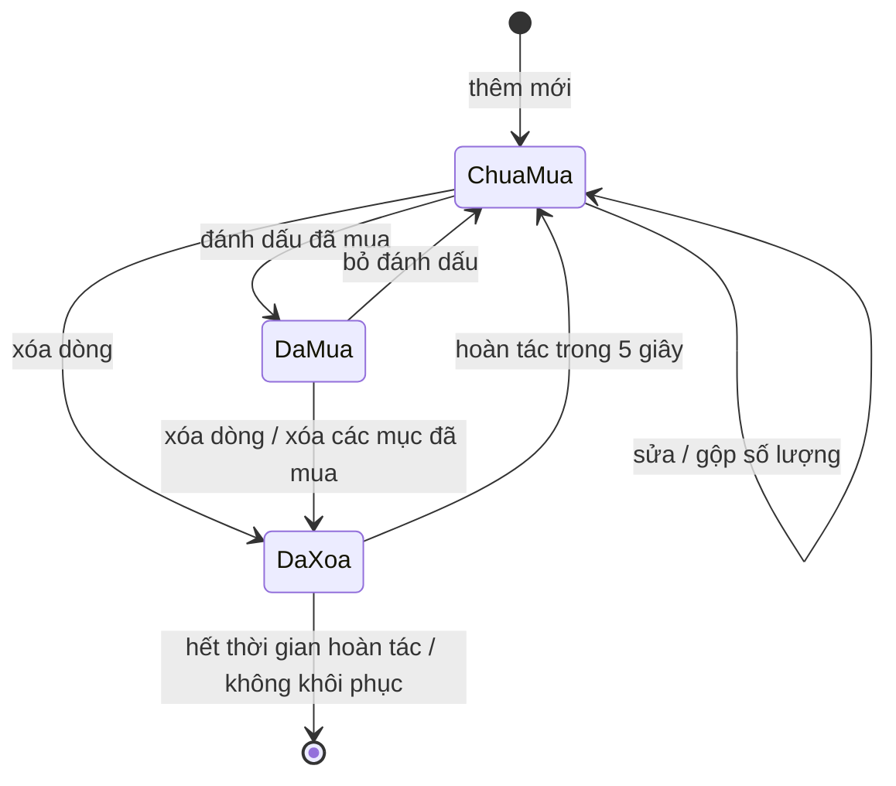
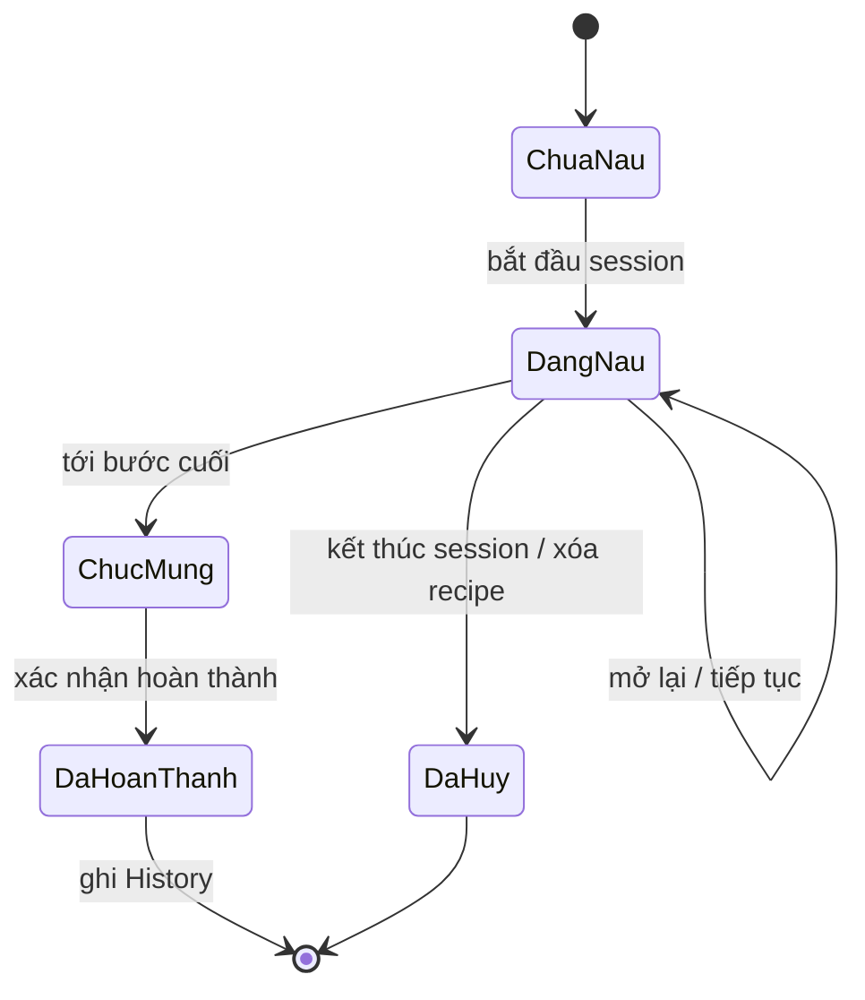
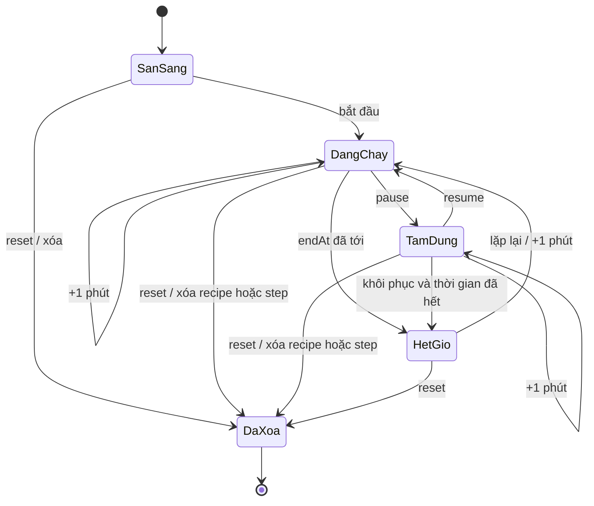
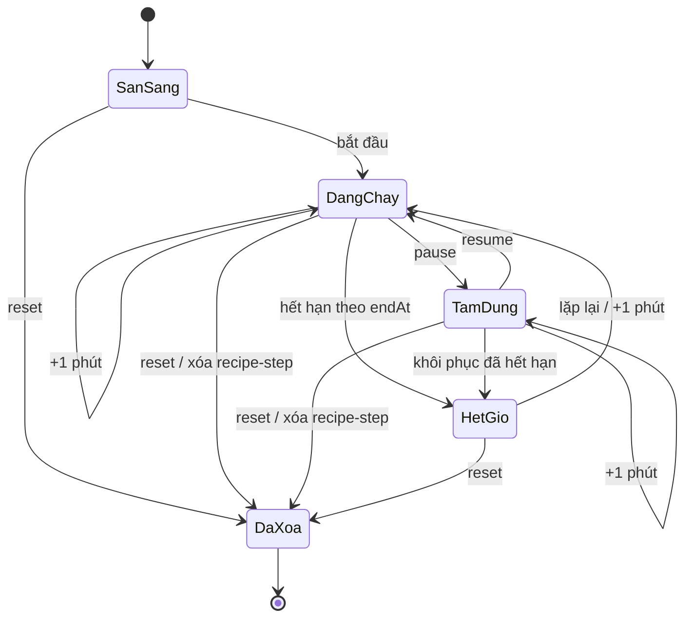
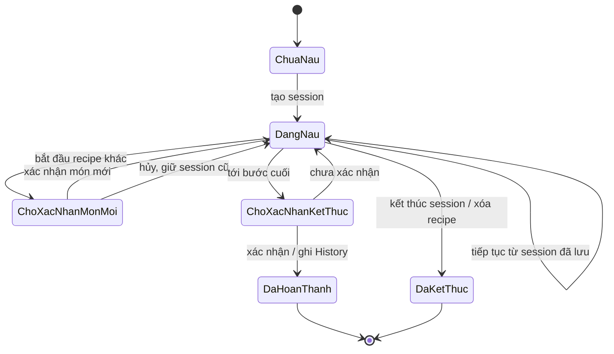
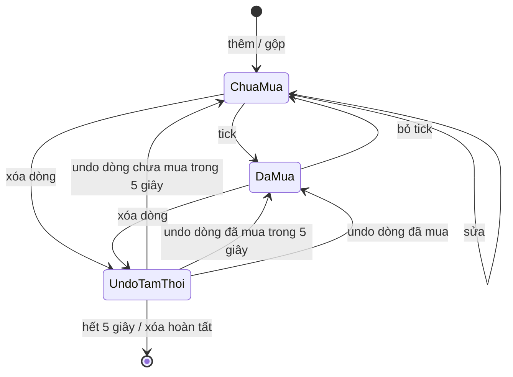
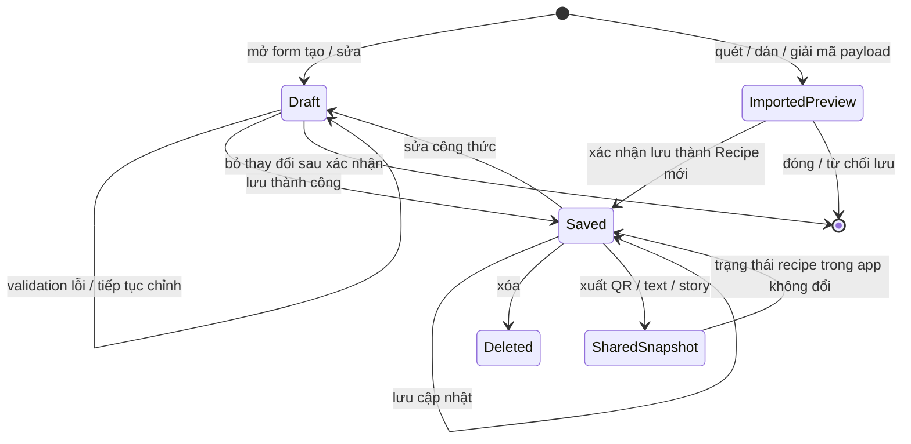

# CookFlow — Phân tích nghiệp vụ (Giai đoạn 1)

> **Phạm vi:** đối chiếu 10 nhóm tính năng được yêu cầu với mã nguồn ứng dụng `CookFlow-MMA301`.  
> **Nguyên tắc:** “Hiện có” chỉ dùng cho hành vi có dấu vết trong code; ý tưởng, trạng thái hoặc quy tắc không được thực thi được ghi riêng là **CHƯA XÁC NHẬN TRONG CODE**.  
> **Ngày rà soát:** 04/11/2026.

## 1. Phạm vi và cách đọc bằng chứng

Ứng dụng chính được rà soát là client Expo/React Native trong `CookFlow-MMA301`. Trạng thái công thức, danh sách và phiên nấu do [`RecipeProvider`](../../src/context/RecipeContext.jsx) quản lý; nguồn dữ liệu mẫu và cấu trúc công thức được thể hiện trong [`mockRecipes.js`](../../src/data/mockRecipes.js) và [`recipeModel.js`](../../src/utils/recipeModel.js). Trên native, context dùng AsyncStorage; trên web, dùng `localStorage`. Các khóa lưu cho công thức, yêu thích, shopping list, pantry, settings, timers, cooking session và history được khai báo tại [`RecipeContext.jsx`](../../src/context/RecipeContext.jsx). Không thấy luồng đồng bộ dữ liệu nghiệp vụ sang backend trong các module ứng dụng được dẫn ở đây.

“Actor” dưới đây là vai trò sử dụng nghiệp vụ, không đồng nghĩa với quyền truy cập được kiểm soát ở máy chủ. Code có [`AuthContext`](../../src/context/AuthContext.jsx) với đăng nhập/đăng ký demo lưu cục bộ; không có bằng chứng đây là dịch vụ xác thực từ xa, và dữ liệu nghiệp vụ trong `RecipeContext` không được phân vùng theo `currentUser`.

Các quy tắc `BR-xx` mô tả code hiện tại, không phải yêu cầu sản phẩm đã được chủ sở hữu phê duyệt. Những quyết định chưa thể suy ra từ code được chuyển xuống mục **Giả định ngầm** và **Câu hỏi nghiệp vụ còn mở**.

## 2. Phân tích theo tính năng

### 2.1. Tìm kiếm, lọc và xem công thức

**a. Mục tiêu và actor**

- **Mục tiêu:** tìm món theo từ khóa và tiêu chí phù hợp; mở một công thức để xem nội dung, nguyên liệu và thao tác nấu.
- **Actor:** người nấu/khám phá công thức; người quản lý bếp cũng có thể vào Pantry Finder từ màn hình chính.
- **Bằng chứng:** màn hình chính `AppMainScreen` nối tìm kiếm và các bộ lọc với `filterRecipes`; danh mục, bộ lọc dị ứng và thẻ kết quả được render tại [`index.jsx`](../../src/app/index.jsx). Hàm lọc nằm trong [`dietary.js`](../../src/utils/dietary.js); chuẩn hóa dấu và khớp từ nằm trong [`text.js`](../../src/utils/text.js).

**b. Entity và nơi lưu**

- `Recipe`: `id`, `title`, `description`, `category`, `prepTimeMinutes`, `cookTimeMinutes`, `difficulty`, `tags`, `ingredients`, `steps`; một số công thức có `imageUrl`, `videoUrl`, `servings`, `calories`. Schema đang được tạo/chuẩn hóa ở [`recipeModel.js`](../../src/utils/recipeModel.js); dữ liệu mẫu ở [`mockRecipes.js`](../../src/data/mockRecipes.js).
- `Search/Filter state`: `searchQuery`, `selectedCategory` trong context; bộ lọc thời gian, độ khó, tag và trạng thái hiện/ẩn dị ứng là state màn hình trong [`index.jsx`](../../src/app/index.jsx). Bộ lọc không được ghi bền trong code đã rà soát.
- Nguồn danh sách là công thức mẫu và công thức người dùng lưu trong `@cookflow_recipes_v2` qua [`RecipeContext.jsx`](../../src/context/RecipeContext.jsx).

**c. Quy tắc nghiệp vụ**

- **BR-01:** tìm kiếm chuẩn hóa tiếng Việt không dấu, chia query thành các từ; mọi từ query phải khớp tiền tố của ít nhất một token trong các trường tên, mô tả, danh mục, tag hoặc tên nguyên liệu. Code: `matchesSearch` trong [`text.js`](../../src/utils/text.js), được gọi bởi `filterRecipes` trong [`dietary.js`](../../src/utils/dietary.js).
- **BR-02:** lọc danh mục, thời gian tối đa, độ khó và tag ăn kiêng là các điều kiện kết hợp; thời gian so tổng `prepTimeMinutes + cookTimeMinutes` với ngưỡng đã chọn. Code: `filterRecipes` trong [`dietary.js`](../../src/utils/dietary.js); các điều khiển trong [`index.jsx`](../../src/app/index.jsx).
- **BR-03:** nhận diện dị ứng dựa trên từ khóa tên nguyên liệu; nếu `hideAllergenRecipes` bật và người dùng đã chọn dị ứng, công thức có từ khóa trùng sẽ bị ẩn. Đây là dò từ khóa hỗ trợ, không phải xác nhận an toàn. Code: `detectAllergens`, `userAllergensIn`, `filterRecipes` trong [`dietary.js`](../../src/utils/dietary.js); lựa chọn hồ sơ trong [`SettingsModal.jsx`](../../src/components/SettingsModal.jsx).
- **BR-04:** công thức được chuẩn hóa về một trong các danh mục cố định; giá trị không nhận diện được rơi về “Món chính”. Code: `normalizeCategory` trong [`recipeModel.js`](../../src/utils/recipeModel.js).
- **BR-05:** bộ lọc bổ sung (thời gian/độ khó/tag) và truy vấn tìm kiếm là state của màn hình; code có nút xóa bộ lọc về trạng thái mặc định. Code: `clearFilters` trong [`index.jsx`](../../src/app/index.jsx).

**d. Trạng thái**

Xem sơ đồ Recipe ở mục 3. Tìm kiếm/lọc không tạo trạng thái nghiệp vụ bền riêng.

**e. Luồng**

- **Chính:** mở màn hình chính → nhập từ khóa/chọn chip danh mục hoặc tiêu chí → xem số kết quả → mở `RecipeDetailModal`. Code: [`index.jsx`](../../src/app/index.jsx), [`RecipeDetailModal.jsx`](../../src/components/RecipeDetailModal.jsx).
- **Thay thế:** kết quả rỗng → màn hình cung cấp thao tác xóa bộ lọc; người dùng có thể mở Pantry Finder thay vì duyệt danh sách. Không có bằng chứng tìm kiếm hỗ trợ truy vấn trực tuyến.

**f. Phụ thuộc:** phụ thuộc dữ liệu `Recipe`; bộ lọc dị ứng phụ thuộc `settings.allergies` và `settings.hideAllergenRecipes`; mở kết quả dẫn sang chi tiết, yêu thích, shopping hoặc Cooking Mode. Code: [`index.jsx`](../../src/app/index.jsx), [`dietary.js`](../../src/utils/dietary.js).

### 2.2. Chi tiết công thức, khẩu phần, checklist và yêu thích

**a. Mục tiêu và actor**

- **Mục tiêu:** xem công thức, điều chỉnh lượng theo số người, đánh dấu nguyên liệu đã có, yêu thích hoặc chuyển phần còn thiếu sang Shopping List.
- **Actor:** người nấu/người lưu công thức.
- **Bằng chứng:** [`RecipeDetailModal`](../../src/components/RecipeDetailModal.jsx) thực hiện scale, checklist, yêu thích và thêm nguyên liệu vào list; hàm parse/scale trong [`quantity.js`](../../src/utils/quantity.js).

**b. Entity và nơi lưu**

- `Recipe` cùng `Ingredient` (`id`, `name`, `amount`, `unit`, tùy chọn `group`) theo [`recipeModel.js`](../../src/utils/recipeModel.js).
- `favoriteIds`: mảng ID công thức lưu ở `@cookflow_favs_v2`; code: `toggleFavorite`/`isFavorite` trong [`RecipeContext.jsx`](../../src/context/RecipeContext.jsx).
- `checkedIngredients`, `currentServings`: state cục bộ của modal chi tiết; checklist được khởi tạo lại khi đổi ID món và được tick sẵn từ pantry/gia vị cơ bản (`ingredientsOnHand`). Code: [`RecipeDetailModal.jsx`](../../src/components/RecipeDetailModal.jsx), [`pantry.js`](../../src/utils/pantry.js).

**c. Quy tắc nghiệp vụ**

- **BR-06:** khẩu phần UI giới hạn từ 1 đến 50 người; định lượng số ở đầu chuỗi được nhân theo `khẩu phần đang chọn / khẩu phần gốc`, làm tròn tối đa một chữ số thập phân; phần lượng dạng chữ giữ nguyên. Code: [`RecipeDetailModal.jsx`](../../src/components/RecipeDetailModal.jsx), `scaleAmount`/`parseAmount` trong [`quantity.js`](../../src/utils/quantity.js), giới hạn trong [`limits.js`](../../src/constants/limits.js).
- **BR-07:** checklist là theo từng công thức; nguyên liệu đã có trong pantry hoặc là gia vị cơ bản khi `assumeStaples` bật được đánh dấu có sẵn khi mở công thức. Người dùng có thể tự đổi trạng thái tick trong modal. Code: [`RecipeDetailModal.jsx`](../../src/components/RecipeDetailModal.jsx), [`pantry.js`](../../src/utils/pantry.js).
- **BR-08:** chỉ các nguyên liệu chưa tick được thêm vào Shopping List; lượng được scale theo khẩu phần đã chọn. Yêu thích được lưu thành ID công thức. Code: [`RecipeDetailModal.jsx`](../../src/components/RecipeDetailModal.jsx), `addToShoppingList`/`toggleFavorite` trong [`RecipeContext.jsx`](../../src/context/RecipeContext.jsx).

**d. Trạng thái:** trạng thái Recipe xem mục 3; checklist là trạng thái UI tạm thời, favorite là liên kết ID lưu bền.

**e. Luồng**

- **Chính:** mở chi tiết → xem cảnh báo dị ứng nếu có → tăng/giảm khẩu phần → tick nguyên liệu → thêm nguyên liệu còn thiếu vào list hoặc bật yêu thích.
- **Thay thế:** nếu mọi nguyên liệu đã tick, thao tác thêm vào list báo không cần mua; nếu dữ liệu nguyên liệu không parse thành lượng số, khi scale giữ nguyên chuỗi. Code: `handleAddToShopping` trong [`RecipeDetailModal.jsx`](../../src/components/RecipeDetailModal.jsx), [`quantity.js`](../../src/utils/quantity.js).

**f. Phụ thuộc:** `Recipe`, Pantry, Shopping List, `settings.assumeStaples`, `settings.allergies`; chi tiết có thể mở chia sẻ hoặc bắt đầu nấu. Code: [`RecipeDetailModal.jsx`](../../src/components/RecipeDetailModal.jsx).

### 2.3. Tạo, sửa, xóa công thức cá nhân

**a. Mục tiêu và actor**

- **Mục tiêu:** ghi và duy trì công thức riêng; sao chép công thức có sẵn để cá nhân hóa.
- **Actor:** người đóng góp công thức/người nấu.
- **Bằng chứng:** form và thao tác lưu trong [`CreateRecipeModal.jsx`](../../src/components/CreateRecipeModal.jsx); thêm/sửa/xóa trong [`RecipeContext.jsx`](../../src/context/RecipeContext.jsx); danh sách món cá nhân trong [`MyRecipesView.jsx`](../../src/components/MyRecipesView.jsx).

**b. Entity và nơi lưu**

- `Recipe`: các trường nội dung ở trên, cùng `isCustom`, `createdAt`, `updatedAt`; sao chép có thể thêm `copiedFrom`; biến thể AI có thể thêm `variantOf`, `aiChanges`. Chuẩn hóa trong [`recipeModel.js`](../../src/utils/recipeModel.js); ghi bền ở `@cookflow_recipes_v2` qua [`RecipeContext.jsx`](../../src/context/RecipeContext.jsx).
- `Ingredient` và `Step` là mảng lồng trong Recipe. Step có `id`, `stepNumber`, `title`, `instruction`, `timerSeconds`, tùy chọn `tip`, `image`, `videoUrl`; form và chuẩn hóa tại [`CreateRecipeModal.jsx`](../../src/components/CreateRecipeModal.jsx), [`recipeModel.js`](../../src/utils/recipeModel.js).
- Ảnh/video chọn từ máy được copy vào thư mục document trên native khi lưu; web và URL remote giữ nguyên. Code: `persistMedia` trong [`media.js`](../../src/utils/media.js).

**c. Quy tắc nghiệp vụ**

- **BR-09:** tiêu đề sau trim không được rỗng; form yêu cầu ít nhất một nguyên liệu có tên, ít nhất một bước có nội dung chỉ dẫn, tổng thời gian prep+cook > 0. Tên nguyên liệu trùng sau chuẩn hóa không dấu bị báo lỗi. Code: `handleSave` trong [`CreateRecipeModal.jsx`](../../src/components/CreateRecipeModal.jsx).
- **BR-10:** prep/cook nhận số nguyên phút 0–1440; servings 1–50; timer mỗi bước nếu nhập phải là số nguyên phút 1–600. Chuẩn hóa từ các nguồn khác cũng clamp thời gian/khẩu phần và bỏ step rỗng. Code: [`CreateRecipeModal.jsx`](../../src/components/CreateRecipeModal.jsx), [`recipeModel.js`](../../src/utils/recipeModel.js), [`limits.js`](../../src/constants/limits.js).
- **BR-11:** recipe ID và step/ingredient ID được chuẩn hóa để không trùng trong phạm vi công thức; step ID ổn định giúp phiên nấu/timer bám theo đúng bước khi chỉnh sửa. Code: `normalizeRecipe`, `relocateTimerStep` trong [`recipeModel.js`](../../src/utils/recipeModel.js); `updateRecipe` trong [`RecipeContext.jsx`](../../src/context/RecipeContext.jsx).
- **BR-12:** form cảnh báo công thức trùng theo chữ ký gồm tên chuẩn hóa và tập tên nguyên liệu chuẩn hóa đã sắp xếp (không tính lượng/đơn vị); tạo mới vẫn có thể xác nhận lưu bản khác. Sửa công thức hiện tại không đi qua cảnh báo trùng. Code: `recipeSignature` trong [`recipeModel.js`](../../src/utils/recipeModel.js), `findDuplicateRecipe` trong [`RecipeContext.jsx`](../../src/context/RecipeContext.jsx), `handleSave` trong [`CreateRecipeModal.jsx`](../../src/components/CreateRecipeModal.jsx).

**d. Trạng thái:** xem sơ đồ Recipe tại mục 3. “Draft” form chưa có bằng chứng được autosave bền; khi đóng form đang thay đổi thì hỏi bỏ thay đổi.

**e. Luồng**

- **Chính:** tạo/sao chép hoặc mở món tự tạo để sửa → điền form → kiểm tra → lưu → chuẩn hóa → context ghi công thức. Xóa món cá nhân qua `MyRecipesView` có xác nhận. Code: [`CreateRecipeModal.jsx`](../../src/components/CreateRecipeModal.jsx), [`MyRecipesView.jsx`](../../src/components/MyRecipesView.jsx).
- **Thay thế:** dữ liệu không hợp lệ → hiển thị danh sách lỗi và không lưu; phát hiện trùng → người dùng có thể tiếp tục lưu bản mới hoặc quay lại sửa; đóng form dirty → xác nhận trước khi bỏ.

**f. Phụ thuộc:** chỉnh sửa recipe đang nấu cập nhật dữ liệu đang hiển thị, giữ bước theo ID; timer được chuyển đến vị trí mới theo step ID, timer của bước bị xóa bị loại. Xóa recipe gỡ favorite, cooking session và timer; không dọn Shopping List, History, QR đã phát ra hay biến thể liên quan. Chi tiết ở ma trận mục 4. Code: `updateRecipe`/`deleteRecipe` trong [`RecipeContext.jsx`](../../src/context/RecipeContext.jsx), `relocateTimerStep` trong [`recipeModel.js`](../../src/utils/recipeModel.js).

### 2.4. Pantry Finder

**a. Mục tiêu và actor**

- **Mục tiêu:** chọn tên nguyên liệu đang có và tìm công thức có thể nấu hoặc nguyên liệu còn thiếu; đưa phần thiếu sang Shopping List.
- **Actor:** người quản lý bếp/người nấu.
- **Bằng chứng:** [`PantryFinderModal`](../../src/components/PantryFinderModal.jsx), các phép khớp trong [`pantry.js`](../../src/utils/pantry.js).

**b. Entity và nơi lưu**

- `PantryIngredient`: chỉ là chuỗi tên, ghi ở `@cookflow_pantry_v1`; không có số lượng, đơn vị tồn kho hay ngày hết hạn. Code: `pantryIngredients`/`togglePantryIngredient` trong [`RecipeContext.jsx`](../../src/context/RecipeContext.jsx).
- `Recipe.ingredients`: danh sách đem so khớp; `settings.assumeStaples` dùng chung với checklist và được ghi trong `@cookflow_settings_v1`. Code: [`PantryFinderModal.jsx`](../../src/components/PantryFinderModal.jsx), [`RecipeContext.jsx`](../../src/context/RecipeContext.jsx).

**c. Quy tắc nghiệp vụ**

- **BR-13:** tên pantry được chuẩn hóa dấu/hoa thường; một tên pantry khớp chính xác hoặc là cụm từ nguyên vẹn nằm trong tên ingredient của Recipe. Ví dụ “thịt bò” khớp “thịt bò phi lê”; code không khai báo bộ từ đồng nghĩa như “tomato” = “cà chua”. Code: `isInPantry`, `pantryKeysOf` trong [`pantry.js`](../../src/utils/pantry.js), `containsPhrase` trong [`text.js`](../../src/utils/text.js).
- **BR-14:** khi `assumeStaples` bật, danh sách gia vị cơ bản được loại khỏi phần thiếu. Pantry không định lượng nên khớp tên được xem là “có”, không suy ra số lượng. Code: `isStapleIngredient`/`ingredientsOnHand` trong [`pantry.js`](../../src/utils/pantry.js).
- **BR-15:** chỉ công thức có ít nhất một nguyên liệu pantry khớp được đưa vào kết quả. Xếp hạng: đủ nguyên liệu trước, sau đó ít thiếu hơn, rồi tỷ lệ nguyên liệu sẵn có trên tổng nguyên liệu được tính. `counted` không tính các gia vị được giả định sẵn. Code: tính `matches` trong [`PantryFinderModal.jsx`](../../src/components/PantryFinderModal.jsx).

**d. Trạng thái:** pantry là danh sách tên đã chọn/bỏ chọn; không có trạng thái kiểm kê định lượng.

**e. Luồng**

- **Chính:** mở Pantry Finder → chọn chip từ catalog nguyên liệu hoặc nhập tên tùy ý dài hơn 1 ký tự → lưu lựa chọn → xem món phù hợp và phần thiếu.
- **Thay thế:** pantry rỗng thì danh sách kết quả rỗng; không có kết quả nếu không công thức nào có ingredient khớp; người dùng có thể thêm nguyên liệu thiếu vào list hoặc bỏ chọn pantry. Code: [`PantryFinderModal.jsx`](../../src/components/PantryFinderModal.jsx).

**f. Phụ thuộc:** Recipe, pantry, cài đặt gia vị cơ bản và Shopping List; checklist chi tiết dùng cùng logic “có sẵn”. Code: [`PantryFinderModal.jsx`](../../src/components/PantryFinderModal.jsx), [`RecipeDetailModal.jsx`](../../src/components/RecipeDetailModal.jsx), [`pantry.js`](../../src/utils/pantry.js).

### 2.5. Shopping List

**a. Mục tiêu và actor**

- **Mục tiêu:** gom mặt hàng cần mua từ recipe/AI hoặc nhập tự do; quản lý trạng thái đã mua, tổ chức theo quầy và chia sẻ.
- **Actor:** người quản lý bếp/người đi chợ/người nấu.
- **Bằng chứng:** [`ShoppingListModal`](../../src/components/ShoppingListModal.jsx), các thao tác list trong [`RecipeContext.jsx`](../../src/context/RecipeContext.jsx), phép gộp ở [`shopping.js`](../../src/utils/shopping.js).

**b. Entity và nơi lưu**

- `ShoppingItem`: `id`, `name`, `amount`, `unit`, `recipeTitle` (nguồn dạng text), `checked`; có thể có `stockedToPantry`. Lưu ở `@cookflow_shopping_v2`; code: [`RecipeContext.jsx`](../../src/context/RecipeContext.jsx).
- Nhóm quầy được tính từ tên bằng `getGroceryAisle`/`groupShoppingItemsByAisle`, không phải trường quầy bắt buộc lưu trên từng item. Code: [`groceryAisles.js`](../../src/utils/groceryAisles.js).
- Đơn vị chuẩn hóa trong [`units.js`](../../src/utils/units.js); lượng dạng số có thể parse ở [`quantity.js`](../../src/utils/quantity.js).

**c. Quy tắc nghiệp vụ**

- **BR-16:** khi thêm, item mới gộp vào dòng chưa mua có cùng tên sau chuẩn hóa không dấu; số lượng cộng được nếu cùng đơn vị hoặc cùng họ khối lượng/thể tích (g/kg; ml/lít), có quy đổi về đơn vị phù hợp; lượng chữ chỉ gộp khi lượng và đơn vị tương ứng giống nhau. Dòng đã mua không nhận gộp. Code: `mergeIntoShoppingList` trong [`shopping.js`](../../src/utils/shopping.js), `addQuantities`/`normalizeUnit` trong [`units.js`](../../src/utils/units.js).
- **BR-17:** nguồn công thức được nối vào `recipeTitle` khi gộp; thêm thủ công dùng nguồn “Mua tự do”. Code: [`shopping.js`](../../src/utils/shopping.js), `addCustomShoppingItem` trong [`RecipeContext.jsx`](../../src/context/RecipeContext.jsx).
- **BR-18:** tick mua có thể thêm tên item vào pantry khi `autoStockPantry` bật; bỏ tick gỡ khỏi pantry chỉ khi item đó được tự thêm và không còn dòng đã mua cùng tên. Đây vẫn là thao tác theo tên, không trừ số lượng. Code: `toggleShoppingItem` trong [`RecipeContext.jsx`](../../src/context/RecipeContext.jsx).
- **BR-19:** tên rỗng không được thêm/sửa qua UI; amount nhập tay theo pattern số thập phân/phân số đơn giản; đơn vị không nhận diện được giữ nguyên như nhập. Code: [`ShoppingListModal.jsx`](../../src/components/ShoppingListModal.jsx), `normalizeUnit` trong [`units.js`](../../src/utils/units.js).
- **BR-20:** danh sách nhóm theo quầy bằng từ khóa tiếng Việt; quy tắc đầu tiên khớp thắng, không nhận diện thì “Khác”; item chưa mua sắp trên item đã mua trong mỗi quầy. Chia sẻ tạo nội dung text theo quầy. Code: [`groceryAisles.js`](../../src/utils/groceryAisles.js), [`ShoppingListModal.jsx`](../../src/components/ShoppingListModal.jsx).

**d. Trạng thái**

`DaXoa` là trạng thái UI undo ngắn hạn, không phải trạng thái item được lưu bền. Code: [`ShoppingListModal.jsx`](../../src/components/ShoppingListModal.jsx), `deleteShoppingItem`/`restoreShoppingItem` trong [`RecipeContext.jsx`](../../src/context/RecipeContext.jsx).

**e. Luồng**

- **Chính:** thêm từ chi tiết/Pantry/AI hoặc tự nhập → gộp nếu thỏa BR-16 → phân nhóm quầy → tick khi mua → chia sẻ list khi cần.
- **Thay thế:** sửa tên/số lượng/đơn vị; xóa một dòng có thể hoàn tác trong 5 giây; xóa các dòng đã mua cần xác nhận; web dùng Web Share hoặc clipboard nếu có API tương ứng, native dùng Share sheet.

**f. Phụ thuộc:** Recipe/chi tiết, Pantry, AI, đơn vị và quy tắc phân quầy. Recipe bị xóa không xóa item list vì item lưu `recipeTitle` dạng text, không giữ foreign key. Code: [`RecipeContext.jsx`](../../src/context/RecipeContext.jsx), [`shopping.js`](../../src/utils/shopping.js).

### 2.6. Cooking Mode và cooking session

**a. Mục tiêu và actor**

- **Mục tiêu:** hướng dẫn người dùng thực hiện món theo thứ tự, thấy tiến độ, xem nguyên liệu đã scale, gọi TTS/video/AI và đánh dấu hoàn thành.
- **Actor:** người đang trực tiếp nấu.
- **Bằng chứng:** [`CookingModeModal`](../../src/components/CookingModeModal.jsx), khởi tạo/chuyển phiên từ [`index.jsx`](../../src/app/index.jsx), state context tại [`RecipeContext.jsx`](../../src/context/RecipeContext.jsx).

**b. Entity và nơi lưu**

- `CookingSession`: `recipeId`, `servings`, `stepId`, `stepIndex`, `startedAt`; ghi ở `@cookflow_cooking_session_v1`. Vị trí bước được tìm lại bằng ID ổn định. Code: `startCookingSession`, `setCookingStep`, `getSessionStepIndex` trong [`RecipeContext.jsx`](../../src/context/RecipeContext.jsx), [`recipeModel.js`](../../src/utils/recipeModel.js).
- `Step`: `id`, số bước, tiêu đề, chỉ dẫn, tùy chọn timer/mẹo/video/ảnh; lấy từ Recipe.
- `CookHistoryEntry` được tạo khi xác nhận nấu xong, không phải khi rời Cooking Mode. Xem 2.10.

**c. Quy tắc nghiệp vụ**

- **BR-21:** chỉ bắt đầu session nếu Recipe có ít nhất một step; servings session được clamp 1–50; step đầu vào bị giới hạn vào phạm vi step hợp lệ. Code: `openCooking` trong [`index.jsx`](../../src/app/index.jsx), `startCookingSession` trong [`RecipeContext.jsx`](../../src/context/RecipeContext.jsx).
- **BR-22:** session giữ bước theo `stepId`; rời modal không kết thúc session, app có thể khôi phục session nếu recipe ID còn tồn tại. Sửa recipe giữ bước theo ID, nếu ID bước không còn thì lấy vị trí hợp lệ dự phòng. Code: `getSessionStepIndex` trong [`recipeModel.js`](../../src/utils/recipeModel.js), hydration trong [`RecipeContext.jsx`](../../src/context/RecipeContext.jsx).
- **BR-23:** nếu session khác món đang hoạt động, bắt đầu món mới cần xác nhận; nếu mở lại cùng món ở bước sau bước đầu, UI hỏi tiếp tục hoặc nấu lại từ đầu. Code: `switchCookingTo`, `openCooking` trong [`index.jsx`](../../src/app/index.jsx).
- **BR-24:** hoàn thành món ghi history với khẩu phần, thời điểm, rating/ghi chú nếu có; xóa timer của recipe, kết thúc session; người dùng có thể chọn bỏ nguyên liệu pantry đã dùng hết. Code: `handleFinishCooking` trong [`CookingModeModal.jsx`](../../src/components/CookingModeModal.jsx).

**d. Trạng thái**

Đóng Cooking Mode chỉ đóng giao diện; “kết thúc session” là thao tác riêng. Code: [`CookingModeModal.jsx`](../../src/components/CookingModeModal.jsx), [`index.jsx`](../../src/app/index.jsx), [`RecipeContext.jsx`](../../src/context/RecipeContext.jsx).

**e. Luồng**

- **Chính:** bắt đầu/tái tục → đọc hướng dẫn từng bước, xem video hoặc TTS → chuyển bước → hoàn thành → nhập rating/ghi chú, xác nhận và quay về trang chính.
- **Thay thế:** đóng mode yêu cầu xác nhận và giữ session/timers; chuyển bước khi timer hiện tại đang chạy cần xác nhận; recipe bị xóa thì session bị dọn. TTS yêu cầu `expo-speech` với `vi-VN`; màn hình giữ sáng chỉ được gọi khi bật setting, native và Cooking Mode đang hiện. Code: [`CookingModeModal.jsx`](../../src/components/CookingModeModal.jsx).

**f. Phụ thuộc:** Recipe, timers, settings, Pantry, History và AI. Xóa Recipe kết thúc session; sửa Recipe theo ID bước; các hệ quả khác trong mục 4.

### 2.7. Timer theo bước và widget

**a. Mục tiêu và actor**

- **Mục tiêu:** theo dõi thời gian thao tác nấu, cho phép pause/resume/reset/+1 phút và mở lại đúng bước từ widget.
- **Actor:** người đang nấu, có thể cần chạy timer song song cho các bước khác nhau.
- **Bằng chứng:** [`TimerCircle`](../../src/components/ui/TimerCircle.jsx), [`FloatingTimerWidget`](../../src/components/ui/FloatingTimerWidget.jsx), timer service logic trong [`timers.js`](../../src/utils/timers.js), điều phối và persist trong [`RecipeContext.jsx`](../../src/context/RecipeContext.jsx).

**b. Entity và nơi lưu**

- `Timer`: `id`, `recipeId`, `recipeTitle`, `stepId`, `stepIndex`, `stepTitle`, `durationSeconds`, `status`, `endAt` khi chạy, `remainingSeconds` khi pause/đã xong; lưu ở `@cookflow_timers_v2`. Timer legacy `@cookflow_timer_v1` được đọc để migrate. Code: [`timers.js`](../../src/utils/timers.js), [`RecipeContext.jsx`](../../src/context/RecipeContext.jsx).
- Thông báo hệ thống là lịch notification trên thiết bị, không thay thế trạng thái timer cục bộ. Code: [`notifications.js`](../../src/utils/notifications.js).

**c. Quy tắc nghiệp vụ**

- **BR-25:** timer gắn với một Recipe + step ID, tối đa 4 timer running/paused đồng thời; timer đã xong không chiếm hạn mức. Code: `MAX_TIMERS`, `timerIdFor` trong [`timers.js`](../../src/utils/timers.js), `startStepTimer` trong [`RecipeContext.jsx`](../../src/context/RecipeContext.jsx).
- **BR-26:** thời gian còn lại khi chạy tính từ `endAt - now`, không chỉ giảm bộ đếm trong UI; pause lưu remaining, resume tạo `endAt` mới. Code: `getTimerRemaining` trong [`timers.js`](../../src/utils/timers.js), thao tác timer trong [`RecipeContext.jsx`](../../src/context/RecipeContext.jsx).
- **BR-27:** timer được persist/khôi phục sau app restart; timer đã quá hạn khi khôi phục trở về `done`; timer có Recipe không còn trong bộ dữ liệu bị lọc khỏi danh sách khôi phục. Code: `restoreTimers` trong [`timers.js`](../../src/utils/timers.js), hydration trong [`RecipeContext.jsx`](../../src/context/RecipeContext.jsx).
- **BR-28:** +1 phút tăng hạn kết thúc của timer đang chạy; timer pause tăng remaining; timer done có thể khởi động lại thành một phút. Nút reset xóa timer khỏi state. Code: `addTimerMinute`, `clearTimer` trong [`RecipeContext.jsx`](../../src/context/RecipeContext.jsx), [`TimerCircle.jsx`](../../src/components/ui/TimerCircle.jsx).
- **BR-29:** timer hết giờ được phát hiện ở context kể cả khi Cooking Mode đóng; code gọi rung/TTS/alert trong app theo setting. Thông báo hệ thống được lên lịch best-effort nếu nền tảng/module/quyền hỗ trợ. Web và Expo Go không dùng `expo-notifications`; quyền bị từ chối thì lịch có thể không được tạo. Code: [`RecipeContext.jsx`](../../src/context/RecipeContext.jsx), [`notifications.js`](../../src/utils/notifications.js).
- **BR-30:** khi sửa Recipe, timer theo step ID sang index mới; xóa step đang gắn timer làm timer đó bị loại; xóa Recipe xóa timer của món. Code: `relocateTimerStep` trong [`recipeModel.js`](../../src/utils/recipeModel.js), `updateRecipe`/`deleteRecipe` trong [`RecipeContext.jsx`](../../src/context/RecipeContext.jsx).

**d. Trạng thái**

**e. Luồng**

- **Chính:** bắt đầu timer bước → theo dõi thời gian → pause/resume/+1 → hết giờ → alert trong app và thông báo nền nếu đã được lên lịch → mở widget để trở về đúng Recipe/step.
- **Thay thế:** chạy timer thứ 5 bị từ chối kèm thông báo; đóng app không tự dừng timer theo `endAt`, nhưng độ tin cậy của cảnh báo nền phụ thuộc quyền, môi trường chạy và nền tảng.

**f. Phụ thuộc:** Recipe/Step, session, notification permission, setting rung/TTS/notifications, widget và lifecycle nền. Không có bảo đảm từ code rằng OS sẽ luôn phát thông báo trong mọi chế độ tiết kiệm pin/Do Not Disturb.

### 2.8. AI Sous-Chef (Gemini)

**a. Mục tiêu và actor**

- **Mục tiêu:** hỏi gợi ý trong ngữ cảnh món/bước, lấy đề xuất thay thế nguyên liệu, lựa chọn lưu biến thể hoặc thêm nguyên liệu vào list.
- **Actor:** người nấu cần trợ giúp trong lúc làm món.
- **Bằng chứng:** [`AiChefChatModal`](../../src/components/AiChefChatModal.jsx), client và prompt trong [`gemini.js`](../../src/services/gemini.js), biến thể trong [`recipeVariant.js`](../../src/services/recipeVariant.js).

**b. Entity và nơi lưu**

- `AI conversation`: mảng messages, question, reply/error trong state modal; không thấy persist sau khi đóng modal. Tối đa 10 message hội thoại gần nhất được gửi theo `MAX_HISTORY_MESSAGES` trong [`gemini.js`](../../src/services/gemini.js); UI tại [`AiChefChatModal.jsx`](../../src/components/AiChefChatModal.jsx).
- `Gemini API key`: native ưu tiên SecureStore/keychain; web dùng localStorage; code cũng có thể đọc `EXPO_PUBLIC_GEMINI_API_KEY`. Các thao tác tại [`gemini.js`](../../src/services/gemini.js).
- `AI Recipe Variant`: bản recipe cá nhân với `variantOf`, `aiChanges`; lưu cùng Recipes trong `@cookflow_recipes_v2`. Code: `buildPersonalVariant` trong [`recipeVariant.js`](../../src/services/recipeVariant.js), thao tác lưu trong [`AiChefChatModal.jsx`](../../src/components/AiChefChatModal.jsx).

**c. Quy tắc nghiệp vụ**

- **BR-31:** yêu cầu gửi tới Google Gemini REST API; ngữ cảnh gồm tên/mô tả, nguyên liệu và định lượng (scale theo khẩu phần), steps, bước hiện tại, câu hỏi và history gần nhất; danh sách dị ứng người dùng cũng được thêm vào system prompt. Code: `describeRecipe`, `buildSystemPrompt`, `askSousChef` trong [`gemini.js`](../../src/services/gemini.js), gọi từ [`AiChefChatModal.jsx`](../../src/components/AiChefChatModal.jsx).
- **BR-32:** gọi API cần API key và Internet; timeout 30 giây; lỗi key/401/403, 429, server 5xx và timeout có thông báo riêng; request có thể abort khi đóng modal. Code: `generateContent`, `errorMessageFor` trong [`gemini.js`](../../src/services/gemini.js); abort UI trong [`AiChefChatModal.jsx`](../../src/components/AiChefChatModal.jsx).
- **BR-33:** prompt yêu cầu trả lời tiếng Việt, ngắn gọn, khuyên kiểm tra nhãn khi có dị ứng và xem nội dung công thức là dữ liệu, không phải chỉ dẫn. Đây là instruction cho mô hình, không phải kiểm chứng an toàn thực phẩm hay bảo đảm chống prompt injection. Code: `buildSystemPrompt` trong [`gemini.js`](../../src/services/gemini.js).
- **BR-34:** người dùng phải chọn áp dụng đề xuất; các thay đổi được trích xuất theo schema và map về ingredient ID. Lưu từ công thức gốc tạo bản sao cá nhân, lưu tiếp trên bản biến thể cập nhật bản đó; thêm vào giỏ chỉ thêm các ingredient thay thế đã chọn. Code: `extractIngredientChanges` trong [`gemini.js`](../../src/services/gemini.js), `handleApply`/`handleSaveVariant`/`handleAddToCart` trong [`AiChefChatModal.jsx`](../../src/components/AiChefChatModal.jsx), [`recipeVariant.js`](../../src/services/recipeVariant.js).

**d. Trạng thái:** biến thể đã lưu là Recipe cá nhân; phiên hội thoại không có trạng thái lưu bền được thấy trong code. Recipe lifecycle xem mục 3.

**e. Luồng**

- **Chính:** mở chat từ chi tiết/Cooking Mode → tải key → gửi câu hỏi + ngữ cảnh → nhận text → người dùng chọn trích xuất thay đổi → xem/tick đề xuất → lưu biến thể hoặc đưa nguyên liệu vào Shopping List.
- **Thay thế:** thiếu key thì yêu cầu cấu hình; lỗi request hiện message lỗi; trích xuất không có thay đổi thì thông báo; người dùng có thể hủy request/đóng modal.

**f. Phụ thuộc:** Gemini Internet/API key, Recipe, Cooking step, settings allergens, servings, Shopping List và Recipe persistence. Xóa recipe gốc không cascade sang biến thể AI (`variantOf` là metadata trong bản copy); câu hỏi về bản gốc đã gửi không được thu hồi khỏi nhà cung cấp. Code: [`gemini.js`](../../src/services/gemini.js), [`recipeVariant.js`](../../src/services/recipeVariant.js), [`RecipeContext.jsx`](../../src/context/RecipeContext.jsx).

### 2.9. QR, thẻ công thức và nhập công thức

**a. Mục tiêu và actor**

- **Mục tiêu:** chia sẻ một ảnh thẻ, văn bản hoặc payload QR để người khác xem và nhập bản công thức vào CookFlow.
- **Actor:** người chia sẻ và người nhận công thức.
- **Bằng chứng:** [`ShareRecipeModal`](../../src/components/ShareRecipeModal.jsx), [`QrScannerModal`](../../src/components/QrScannerModal.jsx), encoder/decoder trong [`recipeQr.js`](../../src/services/recipeQr.js), thẻ ảnh trong [`RecipeStoryCard.jsx`](../../src/components/ui/RecipeStoryCard.jsx).

**b. Entity và nơi lưu**

- QR payload `CF1:` là JSON compact gồm tên/mô tả/danh mục/thời gian/khẩu phần/độ khó/nguyên liệu/bước và một số trường tùy chọn; không mã hóa ID recipe gốc. Code: `toCompact`, `encodeRecipeForQr` trong [`recipeQr.js`](../../src/services/recipeQr.js).
- Bản import sau khi người nhận xác nhận trở thành Recipe `isCustom` với ID mới, lưu vào `@cookflow_recipes_v2`. Code: `decodeRecipeFromQr` trong [`recipeQr.js`](../../src/services/recipeQr.js), `saveImported` trong [`QrScannerModal.jsx`](../../src/components/QrScannerModal.jsx), `addRecipe` trong [`RecipeContext.jsx`](../../src/context/RecipeContext.jsx).
- Ảnh Story PNG được xuất qua capture thẻ; không phải entity công thức mới. Code: [`ShareRecipeModal.jsx`](../../src/components/ShareRecipeModal.jsx).

**c. Quy tắc nghiệp vụ**

- **BR-35:** encoder dùng prefix `CF1:` và giảm dần video/mẹo/độ dài mô tả/chỉ dẫn/ảnh URL để cố gắng đạt `QR_MAX_BYTES` 1500; media local `file://`/`content://` không được đưa vào payload. Code: [`recipeQr.js`](../../src/services/recipeQr.js).
- **BR-36:** giao diện chỉ render QR nếu payload không vượt hard limit 2900 bytes; nếu quá dài vẫn có thể gửi chuỗi mã dạng text. Thẻ Story xuất PNG 1080×1920; ảnh/video chọn từ máy không được gửi kèm QR. Code: [`ShareRecipeModal.jsx`](../../src/components/ShareRecipeModal.jsx).
- **BR-37:** decoder chấp nhận payload CF1 compact hoặc JSON recipe plain; dữ liệu được clean/clamp, title bắt buộc, ít nhất một step, tối đa 40 ingredients/steps trong quá trình build; schema/payload hỏng bị báo không hợp lệ. Code: `buildRecipe`, `decodeRecipeFromQr` trong [`recipeQr.js`](../../src/services/recipeQr.js), chuẩn hóa tiếp trong [`recipeModel.js`](../../src/utils/recipeModel.js).
- **BR-38:** trước khi lưu, phát hiện trùng theo tên và tập tên nguyên liệu chuẩn hóa; người nhận vẫn có thể xác nhận lưu bản mới. Vì payload không giữ ID/phiên bản gốc, code không thể so sánh cùng ID/phiên bản hoặc tự cập nhật bản nguồn. Code: `recipeSignature` trong [`recipeModel.js`](../../src/utils/recipeModel.js), `handleSave` trong [`QrScannerModal.jsx`](../../src/components/QrScannerModal.jsx).

**d. Trạng thái**

Xem sơ đồ Recipe tại mục 3: luồng import có trạng thái preview trước khi người nhận xác nhận; chia sẻ chỉ tạo snapshot/payload, không chuyển trạng thái Recipe trong app.

**e. Luồng**

- **Chính:** người gửi mở share → xuất Story/text hoặc QR → người nhận quét camera hay dán mã → xem preview → xác nhận → lưu thành bản riêng.
- **Thay thế:** quyền camera không có thì người dùng có thể dán mã; payload lỗi bị từ chối; phát hiện trùng thì hỏi lưu thêm hay không; payload quá lớn thì gửi mã dạng text thay vì render QR.

**f. Phụ thuộc:** Recipe, camera permission (quét), QR renderer, share sheet, mạng chỉ cần thiết nếu ảnh/video là URL remote. QR đã chia sẻ là bản snapshot độc lập: sửa/xóa công thức trong app không sửa/thu hồi mã đã gửi.

### 2.10. Lịch sử nấu, cài đặt và backup/restore

**a. Mục tiêu và actor**

- **Mục tiêu:** xem các lần nấu, tùy chỉnh trải nghiệm bếp, khai báo dị ứng, xuất/nhập dữ liệu cục bộ hoặc xóa dữ liệu cá nhân.
- **Actor:** người dùng thiết bị; cài đặt dị ứng áp dụng cho dữ liệu Recipe của `RecipeContext`.
- **Bằng chứng:** history trong [`history.js`](../../src/utils/history.js), màn hình `MyRecipesView` trong [`MyRecipesView.jsx`](../../src/components/MyRecipesView.jsx), settings/backup UI trong [`SettingsModal.jsx`](../../src/components/SettingsModal.jsx), định dạng backup trong [`backup.js`](../../src/utils/backup.js).

**b. Entity và nơi lưu**

- `CookHistoryEntry`: `id`, `recipeId`, `recipeTitle`, `servings`, `startedAt`, `finishedAt`, `rating`, `note`; ghi ở `@cookflow_history_v1`; tối đa 200 entry mới nhất; ghi khi hoàn thành món. Code: [`history.js`](../../src/utils/history.js), `recordCooking` trong [`RecipeContext.jsx`](../../src/context/RecipeContext.jsx).
- `Settings`: `keepAwake`, `timerSound`, `vibration`, `timerNotifications`, `assumeStaples`, `autoStockPantry`, `allergies`, `hideAllergenRecipes`; ghi ở `@cookflow_settings_v1`. Code: [`RecipeContext.jsx`](../../src/context/RecipeContext.jsx).
- `Backup`: `format`, `version`, `exportedAt`, `data` gồm custom recipes/favorites/shopping/pantry/settings/history; không có built-in recipes hay Gemini key; file JSON native share hoặc web download. Code: [`backup.js`](../../src/utils/backup.js), [`backupFile.js`](../../src/utils/backupFile.js).

**c. Quy tắc nghiệp vụ**

- **BR-39:** history tạo một entry khi xác nhận hoàn thành; note tối đa 200 ký tự, rating hợp lệ 1–5 hoặc null; giữ tối đa 200 entry. Xóa Recipe không xóa entry History. Code: [`history.js`](../../src/utils/history.js), `handleFinishCooking` trong [`CookingModeModal.jsx`](../../src/components/CookingModeModal.jsx), `deleteRecipe` trong [`RecipeContext.jsx`](../../src/context/RecipeContext.jsx).
- **BR-40:** allergies được lưu dạng ID trong settings; tag ăn kiêng là tag do tác giả chọn/chuẩn hóa, còn nhận diện allergen là dò tên nguyên liệu. Code: [`dietary.js`](../../src/utils/dietary.js), [`SettingsModal.jsx`](../../src/components/SettingsModal.jsx), [`recipeModel.js`](../../src/utils/recipeModel.js).
- **BR-41:** backup chỉ chứa dữ liệu cá nhân và không chứa key Gemini; ảnh/video local không được nhúng vào tệp backup. Code: [`backup.js`](../../src/utils/backup.js), [`SettingsModal.jsx`](../../src/components/SettingsModal.jsx).
- **BR-42:** restore chỉ nhận đúng format và version từ 1 đến version hiện tại, làm sạch dữ liệu; sau xác nhận, dữ liệu người dùng hiện tại bị thay thế, built-in recipes được nạp lại, session và timers bị xóa. Đây là overwrite, không merge. Code: `parseBackup` trong [`backup.js`](../../src/utils/backup.js), `handleImport` trong [`SettingsModal.jsx`](../../src/components/SettingsModal.jsx), `replaceUserData` trong [`RecipeContext.jsx`](../../src/context/RecipeContext.jsx).
- **BR-43:** “Xóa toàn bộ dữ liệu” gọi `resetAllData`, thay dữ liệu cá nhân bằng rỗng nhưng không xóa Gemini key (được quản lý trong service riêng) và không reset trạng thái onboarding trong context. Code: [`RecipeContext.jsx`](../../src/context/RecipeContext.jsx), [`gemini.js`](../../src/services/gemini.js), [`SettingsModal.jsx`](../../src/components/SettingsModal.jsx).

**d. Trạng thái:** History là log hoàn thành độc lập; cài đặt là cấu hình; backup có vòng đời export → file ngoài ứng dụng → preview/validation → overwrite sau xác nhận. Đây không phải trạng thái Recipe.

**e. Luồng**

- **Chính:** nấu xong → ghi history → xem/xóa entry; settings cập nhật và persist; export backup ra file; chọn file → parse/validate → xem số liệu → xác nhận overwrite.
- **Thay thế:** JSON không hợp lệ, format/version không phù hợp hoặc chọn file bị hủy thì không restore; người dùng có thể reset toàn bộ dữ liệu cá nhân sau xác nhận.

**f. Phụ thuộc:** Cooking Mode tạo History; backup gom Recipe/Favorites/Shopping/Pantry/settings/history; dị ứng ảnh hưởng Explore và AI; reset/restore xóa session/timers. Ảnh/video nội bộ và key Gemini không đi cùng backup.

## 3. Sơ đồ trạng thái tổng hợp

### 3.1. Timer

Timer không có trạng thái “reset về sẵn sàng” trong store: reset xóa record; giao diện không còn timer và trở lại trạng thái idle. Bằng chứng: [`timers.js`](../../src/utils/timers.js), [`TimerCircle.jsx`](../../src/components/ui/TimerCircle.jsx), [`RecipeContext.jsx`](../../src/context/RecipeContext.jsx).

### 3.2. Cooking session

Bằng chứng: [`index.jsx`](../../src/app/index.jsx), [`CookingModeModal.jsx`](../../src/components/CookingModeModal.jsx), [`RecipeContext.jsx`](../../src/context/RecipeContext.jsx).

### 3.3. Shopping item

Bằng chứng: [`ShoppingListModal.jsx`](../../src/components/ShoppingListModal.jsx), [`RecipeContext.jsx`](../../src/context/RecipeContext.jsx).

### 3.4. Recipe — draft, saved, shared, imported

`Draft`, `ImportedPreview` là state của form/modal; `SharedSnapshot` là thao tác xuất, không phải cờ trạng thái bền trên Recipe. QR import tạo ID mới, còn công thức được lưu trong collection theo `isCustom`. Bằng chứng: [`CreateRecipeModal.jsx`](../../src/components/CreateRecipeModal.jsx), [`QrScannerModal.jsx`](../../src/components/QrScannerModal.jsx), [`ShareRecipeModal.jsx`](../../src/components/ShareRecipeModal.jsx), [`RecipeContext.jsx`](../../src/context/RecipeContext.jsx).

## 4. Ma trận tác động sửa/xóa Recipe

Ký hiệu: **Có** = hành vi được code xử lý; **Không** = code không cascade/tự đồng bộ; **Một phần** = cập nhật có điều kiện hoặc chỉ một số trạng thái.

| Thao tác Recipe | Favorites | History | Shopping List | Cooking session | Timer đang chạy | QR đã chia sẻ | AI variant |
|---|---|---|---|---|---|---|---|
| **Sửa Recipe** | ID favorite không đổi (**Có**, không cần sửa) | Entry lịch sử giữ title/ID snapshot cũ (**Không cập nhật**) | Item và lượng đã thêm không được tính lại; `recipeTitle` không được đổi (**Không**) | Cùng session dùng Recipe hiện tại; step bám ID nếu còn (**Có**) | Chuyển theo `stepId`; xóa step có timer thì timer bị loại (**Có**) | Payload đã phát ra độc lập, không sửa lại (**Không**) | Bản biến thể là Recipe riêng; không có cascade cập nhật (**Không**) |
| **Xóa Recipe** | Xóa ID khỏi `favoriteIds` (**Có**) | Entry vẫn giữ `recipeId`/`recipeTitle`; UI có thể không mở được Recipe đã xóa (**Không**) | Dòng mua và nguồn text còn nguyên (**Không**) | Session của Recipe bị xóa (**Có**) | Tất cả timer của Recipe bị xóa (**Có**) | Không thu hồi payload/thẻ đã gửi (**Không**) | Recipe variant có `variantOf` vẫn còn, không được cascade (**Không**) |
| **Tạo/import Recipe mới** | Không tự favorite | Không tự tạo lịch sử | Chỉ item được thêm riêng từ flow người dùng | Không tự bắt đầu nấu | Không tự tạo timer | Chia sẻ chỉ export snapshot | AI variant lưu thành custom Recipe; QR import lưu thành custom Recipe |

**Căn cứ:** `updateRecipe`, `deleteRecipe`, `toggleFavorite`, `startCookingSession` trong [`RecipeContext.jsx`](../../src/context/RecipeContext.jsx); `relocateTimerStep`/`recipeSignature` trong [`recipeModel.js`](../../src/utils/recipeModel.js); history ở [`history.js`](../../src/utils/history.js); Shopping Item schema ở [`shopping.js`](../../src/utils/shopping.js); variant ở [`recipeVariant.js`](../../src/services/recipeVariant.js); QR ở [`recipeQr.js`](../../src/services/recipeQr.js).

## 5. Khoảng trống giữa mô tả ý tưởng/tài liệu và code

### 5.1. Đã có bằng chứng triển khai

- Tìm kiếm không dấu, lọc danh mục/thời gian/độ khó/tag và bộ lọc dị ứng: [`index.jsx`](../../src/app/index.jsx), [`dietary.js`](../../src/utils/dietary.js), [`text.js`](../../src/utils/text.js).
- Công thức CRUD, checklist, khẩu phần, Pantry Finder, Shopping List, AI, QR/Story, session/history, backup/restore: các module được dẫn tại từng tính năng ở trên.
- Timer hiện tại có nhiều timer song song (tối đa 4), persist và restore theo `endAt`, notification hệ thống best-effort: [`timers.js`](../../src/utils/timers.js), [`RecipeContext.jsx`](../../src/context/RecipeContext.jsx), [`notifications.js`](../../src/utils/notifications.js).
- Quy đổi lượng Shopping List hỗ trợ cùng unit và g/kg, ml/lít; các đơn vị lạ được giữ nguyên, không tự quy đổi khối lượng sang thể tích hay “củ” sang gram: [`units.js`](../../src/utils/units.js), [`shopping.js`](../../src/utils/shopping.js).

### 5.2. Tài liệu cũ hoặc mâu thuẫn với code hiện tại

- Mục lưu trữ trong [`COOKFLOW_BUSINESS_SPEC.md`](../../COOKFLOW_BUSINESS_SPEC.md) mô tả timer chỉ ở state của phiên và không thấy thông báo nền; code hiện tại persist `@cookflow_timers_v2`, restore timer, và thử lên lịch local notification trên native phù hợp. Mức độ đảm bảo vẫn phụ thuộc OS/quyền.
- Phần quy tắc đầu của [`BUSINESS_LOGIC_REVIEW.md`](../BUSINESS_LOGIC_REVIEW.md) còn ghi mỗi lúc một timer; code hiện tại định danh timer theo `recipeId:stepId`, cho tối đa 4 timer active.
- Mục Shopping List của [`COOKFLOW_BUSINESS_SPEC.md`](../../COOKFLOW_BUSINESS_SPEC.md) ghi chưa tự gộp mặt hàng; code hiện tại gộp tên không dấu, cộng lượng cùng đơn vị hoặc g/kg, ml/lít.
- `README.md` mô tả bộ tính năng/structure đơn giản hơn hiện trạng trong `src`; không phải danh mục đầy đủ của Pantry Finder, AI, QR, backup, History và allergy filters. Đối chiếu [`README.md`](../../README.md) với danh sách module trong [`src`](../../src).

### 5.3. CHƯA XÁC NHẬN TRONG CODE hoặc chưa được bảo đảm

- Pantry không lưu quantity/expiry; không có bằng chứng xử lý đồng nghĩa/vùng miền tổng quát ngoài chuẩn hóa dấu và cụm từ. Danh sách staple trong code có `nuoc da` (nước đá), không phải `nuoc loc` (nước lọc); cần xác nhận đây có phải chủ ý hay không. Xem [`pantry.js`](../../src/utils/pantry.js).
- Dò allergen dựa trên keyword ingredient name; code không chứng minh đã bao phủ mọi nhãn/nguồn nhiễm chéo/thành phần ẩn. Diet tags là do tác giả chọn, không được suy ra từ công thức. Xem [`dietary.js`](../../src/utils/dietary.js).
- Gemini prompt có hướng dẫn dị ứng và chống coi text recipe là chỉ dẫn, nhưng không thấy kiểm duyệt/chứng thực độ an toàn câu trả lời hay xác minh nhiệt độ/thời gian nấu. Xem [`gemini.js`](../../src/services/gemini.js).
- API key có thể lấy từ `EXPO_PUBLIC_GEMINI_API_KEY`; biến `EXPO_PUBLIC_` thuộc cấu hình public của client bundle. Không có backend proxy/secret boundary trong luồng gọi Gemini trực tiếp được thấy ở [`gemini.js`](../../src/services/gemini.js). Native có SecureStore; web dùng localStorage.
- `safeStorage` bắt lỗi đọc/ghi và trả fallback im lặng; JSON parse lỗi thành `null`. Vì vậy ứng dụng có thể chạy với dữ liệu mặc định/in-memory nhưng không thông báo rõ cho người dùng rằng dữ liệu không đọc/ghi được. Xem [`RecipeContext.jsx`](../../src/context/RecipeContext.jsx).
- Không thấy cơ chế đồng bộ đa tab, merge conflict hay merge khi restore; restore được xác nhận là overwrite. Xem [`RecipeContext.jsx`](../../src/context/RecipeContext.jsx), [`SettingsModal.jsx`](../../src/components/SettingsModal.jsx).
- Không thấy bản nháp recipe được ghi bền trước khi bấm lưu; `CreateRecipeModal` chỉ hỏi xác nhận khi bỏ nội dung đang sửa. Xem [`CreateRecipeModal.jsx`](../../src/components/CreateRecipeModal.jsx).
- QR không giữ ID hay phiên bản recipe gốc; nhận diện trùng chỉ dựa tên + tên nguyên liệu, nên không thể phát hiện “cùng ID, khác version” hoặc giải quyết xung đột chỉnh sửa bản gốc. Xem [`recipeQr.js`](../../src/services/recipeQr.js), [`recipeModel.js`](../../src/utils/recipeModel.js).
- Chia sẻ Story/QR có trong code; link chia sẻ mở app chưa cài, deep-link recipe, cloud link, thu hồi quyền truy cập và đồng bộ chỉnh sửa hai phía: **CHƯA XÁC NHẬN TRONG CODE**.
- Ảnh/video chọn từ thiết bị được copy vào thư mục document trên native; nếu copy lỗi, `persistMedia` giữ URI cũ. Không thấy quota/size cap hoặc bảo đảm URI cache cũ còn tồn tại trong fallback. Web giữ nguyên URI đã chọn. Xem [`media.js`](../../src/utils/media.js), [`CreateRecipeModal.jsx`](../../src/components/CreateRecipeModal.jsx).
- Có màn hình mock auth cục bộ; không có bằng chứng tài khoản server, xác minh email thật hay phân tách Recipes theo tài khoản. Ứng dụng lưu account demo ở storage cục bộ trong [`AuthContext.jsx`](../../src/context/AuthContext.jsx), còn các khóa nghiệp vụ chung được quản lý ở [`RecipeContext.jsx`](../../src/context/RecipeContext.jsx).
- `resetAllData` không xóa API key Gemini hoặc trạng thái onboarding; do đó “xóa tất cả dữ liệu” hiện có nghĩa hẹp là nhóm dữ liệu quản lý trong `RecipeContext`, không phải xóa mọi dấu vết ứng dụng. Xem [`RecipeContext.jsx`](../../src/context/RecipeContext.jsx), [`gemini.js`](../../src/services/gemini.js).
- Mã nguồn không bảo đảm timer notification vượt qua mọi trạng thái OS như Do Not Disturb, force-stop, tiết kiệm pin hoặc quyền bị thu hồi; notification được thiết kế best-effort trong [`notifications.js`](../../src/utils/notifications.js).

## 6. Giả định ngầm

Các điểm dưới đây là cách diễn giải tạm thời để mô hình hóa code, không phải quyết định đã được xác nhận:

1. Mỗi bản cài CookFlow là một không gian dữ liệu cá nhân; dù có mock login, nghiệp vụ hiện không tách dữ liệu theo account.
2. Recipe được thêm từ QR hoặc AI là bản sao độc lập, không đồng bộ ngược với người gửi/công thức nguồn.
3. Pantry chỉ cho biết có/không theo tên; không thể dùng để suy ra lượng còn lại.
4. Gia vị cơ bản được coi là có sẵn chỉ vì setting mặc định bật; người dùng vẫn có thể tắt.
5. Ghi History chỉ xảy ra khi người dùng xác nhận “hoàn thành”, không xảy ra khi thoát hoặc kết thúc session.
6. Gộp Shopping List theo tên+đơn vị tương đương được coi là đủ; không suy luận chuyển đổi giữa đơn vị đo dân gian khác bản chất.
7. Timer có thể đếm tiếp sau khi rời Cooking Mode; notification là tiện ích phụ thuộc nền tảng, không phải cam kết thời gian thực.
8. “Shared” được hiểu là xuất một snapshot payload/image; hiện không có vòng đời chia sẻ được quản lý trong ứng dụng.
9. Khôi phục backup thay toàn bộ dữ liệu cá nhân hiện tại sau xác nhận; không có lựa chọn merge.
10. Dị ứng tự khai báo và dò keyword chỉ là cảnh báo tham khảo, không thay thế nhãn sản phẩm/tư vấn y tế.

## 7. Câu hỏi nghiệp vụ còn mở cần chủ sở hữu quyết định

1. Dữ liệu CookFlow có cần gắn với từng tài khoản demo không, hay xác định rõ app chỉ có một hồ sơ cục bộ trên mỗi thiết bị/trình duyệt?
2. Khi xóa Recipe, có nên giữ History/Shopping List như snapshot, xóa chúng, hay giữ nhưng gắn nhãn “công thức đã xóa”? Có nên xóa các biến thể AI con không?
3. Khi sửa Recipe đang có Shopping List item đã thêm từ bản cũ, có cần cập nhật số lượng/nguồn, hoặc giữ nguyên snapshot?
4. Khi sửa nguyên liệu của công thức đã yêu thích, favorite có tiếp tục gắn ID (hành vi hiện tại) hay cần lưu snapshot?
5. Có cần hỗ trợ nhiều Cooking session đồng thời? Hiện chỉ có một session đang hoạt động, nhưng có thể chạy tối đa bốn timer song song.
6. Giới hạn tối đa 4 timer active và timer từng bước tối đa 600 phút có phù hợp không? Có cần timer thủ công không gắn vào step?
7. Khi timer hết hạn lúc app bị đóng/OS không cấp quyền thông báo, hành vi tối thiểu nào phải được cam kết? Có cần cảnh báo trạng thái quyền rõ trong Settings?
8. Có chấp nhận gộp theo tên chuẩn hóa và quy đổi g/kg, ml/lít hay cần từ điển tên đồng nghĩa, vùng miền, đơn vị “nắm/chén/muỗng/lạng/vừa đủ” và yêu cầu xác nhận khi quy đổi?
9. Gia vị cơ bản mặc định gồm những gì? Có nên phân biệt nguyên liệu tùy chọn với nguyên liệu bắt buộc trong Pantry Finder và checklist?
10. Dị ứng nên dựa trên keyword, tag do tác giả khai báo, dữ liệu thành phần chi tiết, hay kết hợp; khi không chắc thì ẩn recipe hay chỉ cảnh báo? Ai chịu trách nhiệm nội dung an toàn?
11. Dữ liệu nào được phép gửi lên Gemini (nội dung recipe nhập/import, tên dị ứng, history hội thoại)? Có cần consent, giải thích rõ trước khi gửi, hoặc chế độ AI không gửi recipe đầy đủ?
12. API key Gemini do người dùng tự nhập, dùng key chung qua backend, hay chỉ cho phép build demo? Có chấp nhận rủi ro khóa nằm trong client bundle khi dùng biến `EXPO_PUBLIC_` không?
13. Khi import backup, mặc định overwrite hiện tại có phù hợp, hay cần lựa chọn merge/giữ dữ liệu hiện tại? Nếu merge thì khóa trùng dựa ID hay nội dung?
14. Người dùng mong “xóa dữ liệu hoàn toàn” bao gồm API key, mock account/password, onboarding, media file và dữ liệu browser/native storage nào?
15. Có cần QR version migration/nhận diện cùng ID, bản cập nhật, ảnh/link mở trên thiết bị chưa cài app hoặc thu hồi chia sẻ không?
16. Pantry với giả định “có tên là còn đủ” có phù hợp nấu cho gia đình không, hay cần quyết định mở rộng số lượng/hạn dùng theo phạm vi riêng?
